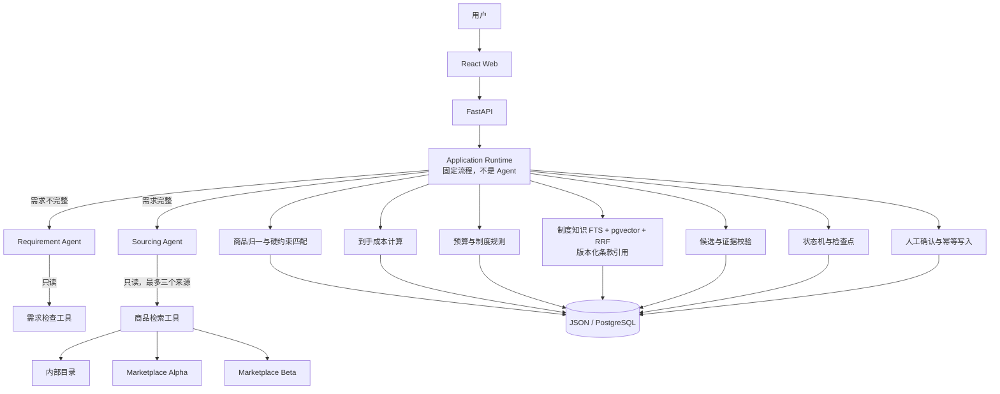
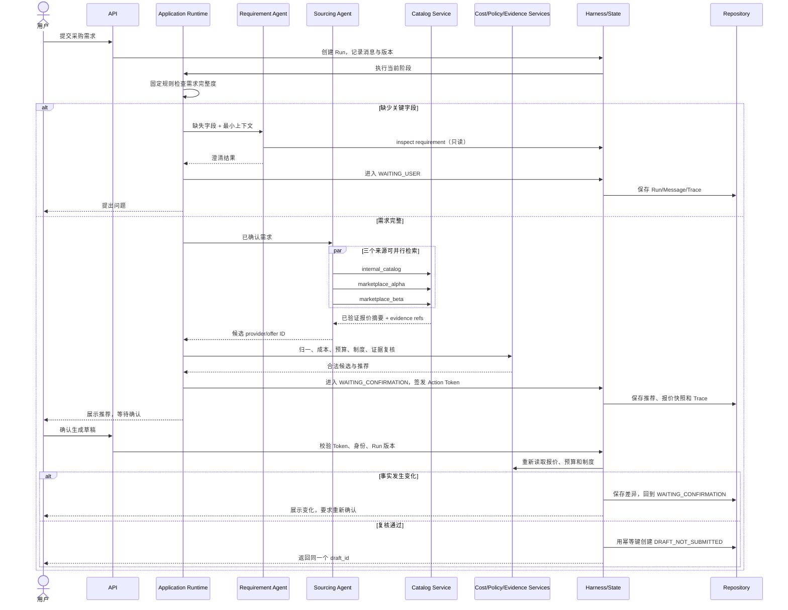

# ProcurePilot 架构：两个 Agent + 确定性服务

## 1. 一句话说明

ProcurePilot 只把“需要理解和权衡”的工作交给模型，把“必须算对、查对、按规则执行”的工作交给普通代码。

因此，系统只有两个 Agent：

- **Requirement Agent（需求 Agent）**：识别还缺哪些关键信息，帮助系统提出最少、最有价值的问题。
- **Sourcing Agent（寻源 Agent）**：查看多个已授权商品来源，在真实返回的报价中提出一个候选。

总控不是 Agent。`Application Runtime` 用固定代码根据需求是否完整选择要执行的 Agent。预算、金额、制度、证据、状态、确认和写入也都不是 Agent。

## 2. 为什么只保留两个 Agent

判断一项工作是否应当成为 Agent，可以问三个问题：

1. 它是否需要理解开放式自然语言？
2. 它是否需要在多个合理答案间做语义权衡？
3. 它是否无法用稳定、可测试的规则直接得到唯一答案？

需求澄清和多来源选品满足这些条件。下面这些工作不满足：

- `总价 = 单价 × 数量 + 税费 + 运费` 有固定公式；
- 是否超预算可以直接比较两个 `Decimal`；
- 制度允许、拒绝或需要谁审批由版本化规则决定；
- 状态能否迁移由状态表决定；
- 是否可以创建草稿取决于用户确认、权限、报价复核和幂等键；
- 候选 ID 和证据是否真实存在可以由服务端集合校验。

把这些工作做成 Agent 不会增加智能，只会增加模型调用、延迟、费用和不稳定性。

## 3. 当前架构图

边界口诀：**Agent 提建议，服务端做决定；Agent 只读，写入必须确认。**

## 4. 两个 Agent 分别做什么

| 角色 | 何时执行 | 能看到什么 | 能调用什么 | 输出 | 不能做什么 |
|---|---|---|---|---|---|
| Requirement Agent | 需求缺关键字段 | 当前结构化需求、缺失字段、最近一条消息 | `inspect_procurement_requirement` | 缺失字段及澄清建议 | 擅自填写预算、数量、地点；改状态；写数据库 |
| Sourcing Agent | 需求达到最小完整度 | 已确认需求、自己的检索结果 | `search_catalog` | 一个真实 provider/offer ID 与目录证据 | 计算最终金额；读预算；决定制度；审批；创建草稿 |

两个角色各自拥有独立 Prompt、模型执行、输入投影、工具白名单、额度和 Trace，所以它们是两个真正独立的 Agent 边界。它们不是五个函数的不同名称。

## 5. 确定性服务分别做什么

| 服务 | 输入 | 确定性输出 | 为什么不用 Agent |
|---|---|---|---|
| Requirement Validation | 结构化需求 | 是否完整、缺失字段、问题排序 | 字段规则可枚举、可测试 |
| Catalog Normalization & Match | 原始报价 | Product/Variant/Offer、接受或拒绝 | 型号、RAM、存储、成色等是硬约束 |
| Cost Service | 报价、数量、税费、运费 | 精确到手总价 | 必须使用 `Decimal` 和固定公式 |
| Budget & Policy Service | 员工、预算、供应商、金额、制度版本 | `ALLOW` / `ALLOW_WITH_APPROVAL` / `DENY` | 公司制度不能由模型自由解释后改写 |
| Policy Knowledge Retrieval | tenant、品类、生效时间、查询 | 版本化条款引用或人工复核信号 | RAG 负责解释与引用，不能覆盖规则裁决 |
| Evidence Validation | Agent 候选、当前 Run 已查结果 | 接受候选或否决 | 必须证明 ID 和引用来自本次可信检索 |
| State & Checkpoint | 当前状态、事件、版本 | 新状态与版本 | 非法迁移必须 100% 拒绝 |
| HITL & Write | 用户确认、Action Token、复核结果、幂等键 | 同一个采购草稿或安全停止 | 写操作需要权限、确认和唯一性保证 |

## 6. 一个 Run 的生命周期

## 7. Runtime 和 Harness 如何分工

`Application Runtime` 决定业务顺序：

- 需求不完整时只执行 Requirement Agent；
- 需求完整时只执行 Sourcing Agent；
- Agent 返回后依次执行固定的业务服务；
- 决定等待用户、等待确认、失败或创建草稿。

`Harness` 约束每一次执行：

- 状态和 `state_version`：旧版本 Agent 结果不能覆盖新输入；
- 权限：角色、工具名和风险等级共同决定能否调用；
- 预算：模型请求、Agent 回合、工具、Provider、token、费用和墙钟时间；
- 超时/重试/熔断：读取可以有限重试，不安全写入不能盲目重试；
- Trace：记录谁在什么版本调用了什么、结果和证据是什么；
- HITL：Business Write 必须携带有效 Action Token；
- 幂等：重复确认不会创建第二个草稿。

## 8. 模型选错工具或参数怎么办

模型看不到任意工具注册表，只能看到当前 Agent 的静态白名单。Requirement Agent 只有一个无参数工具；Sourcing Agent 只有一个强类型工具，`provider` 只能是三个枚举值。

如果仍然出错：

1. SDK/Pydantic 先拒绝不符合 Schema 的参数；
2. 工具层拒绝重复 provider、未知 offer 或不完整需求；
3. Harness 记录拒绝原因并限制重试次数；
4. Runtime 校验 Agent 类型、task ID、`state_version`、工具 Trace 和调用额度；
5. Engine 再校验候选是否来自本 Run 的搜索结果、引用是否属于该商品；
6. 任一层失败都回退到确定性排序，绝不允许模型失败扩大为写操作。

## 9. 当前与后续边界

当前已实现：两个 Agent、确定性业务服务、状态机、执行预算、三来源并行读取、有限重试/熔断、证据校验、人工确认、写前复核、幂等草稿、JSON/PostgreSQL Repository、长期记忆闭环，以及制度文档版本化发布、FTS/pgvector 双路召回、RRF 重排和条款引用。

M2.1 已将授权长期记忆通过 ContextAssembler 接入两个 Agent，M2.2 已完成受控 Key/Category/Tag、结构化值和 Consent，M2.3 已完成安全终态候选提取、用户确认和幂等写入。制度 RAG 已完成混合检索最小纵向切片；下一步补 PDF/DOCX/OCR ingestion、真实 embedding provider 与更大标注集，再继续持久化 Agent execution/checkpoint、跨进程租约、真实 Provider 更大样本评测和受控 Agent 进化。
