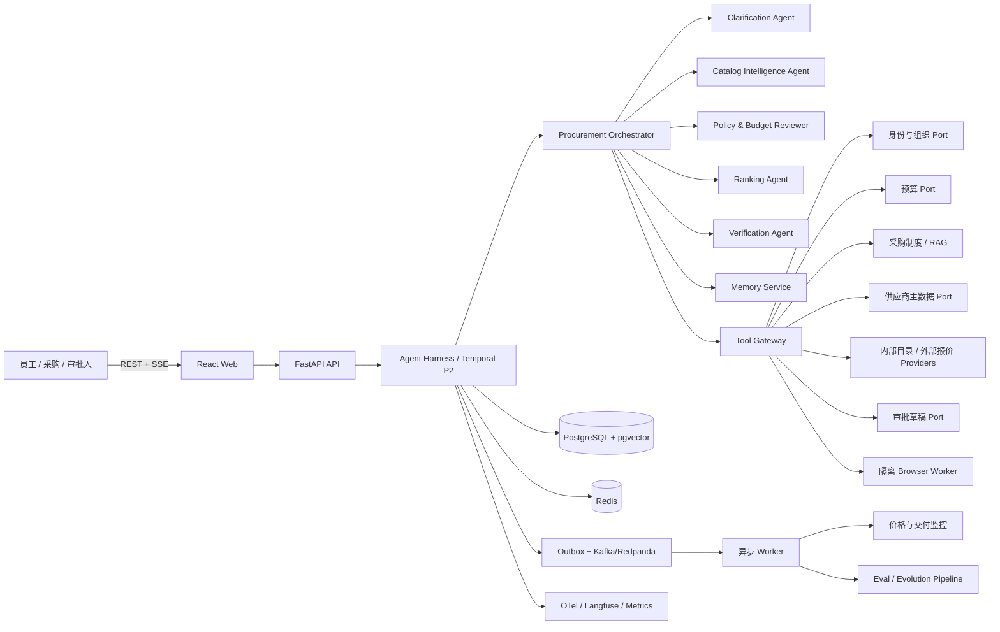
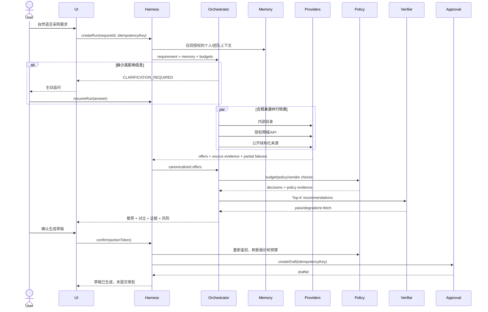
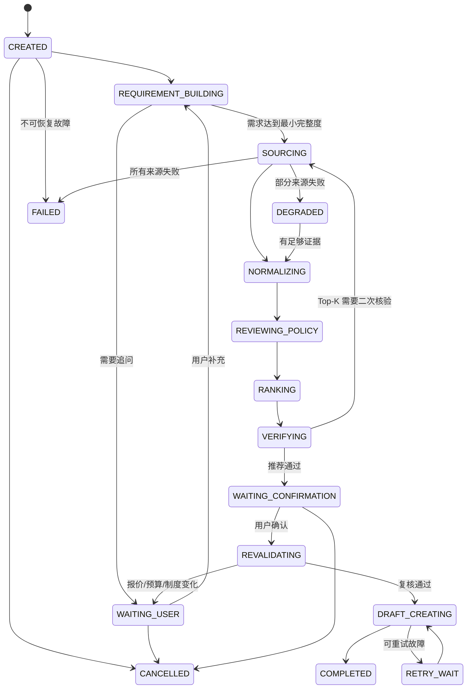
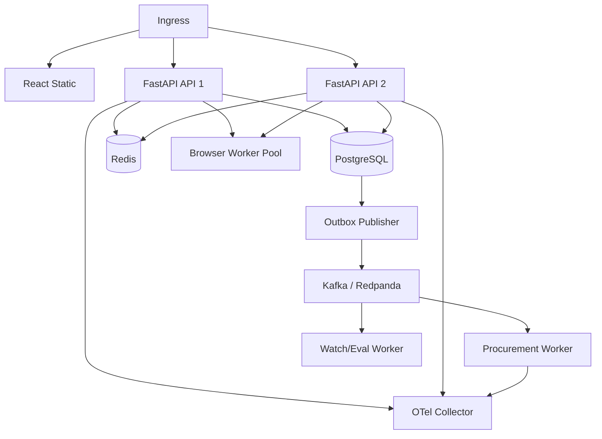

# 技术方案与项目架构

## 1. 架构目标

ProcurePilot 的核心不是“聊天生成采购建议”，而是建立一条可追踪、可暂停、可恢复、可评测的企业采购决策链路：

- 面对模糊需求能够主动补齐信息；
- 面对多个报价来源能够并行检索、归一和核验；
- 面对预算、制度和权限能够以服务端事实为准；
- 面对外部故障能够部分成功、有限重试和恢复；
- 面对写操作能够 HITL、幂等、审计和补偿；
- 面对模型不确定性能够回放、评测、灰度和回滚。

## 2. 系统上下文



原则：LLM 管理语义不确定性，Harness 管理执行不确定性，领域服务管理事实和副作用。

## 3. 分层与依赖方向

```text
interfaces        REST/SSE/Webhook/Admin API
      ↓
application       Use Case、Procurement Orchestrator、Run Engine
      ↓
domain            采购需求、报价、金额、制度判定、草稿、状态机
      ↓
ports             模型、身份、预算、制度、供应商、目录、审批、通知
      ↑
adapters          Agents SDK/OpenAI、Postgres、Redis、Provider、Mock、Browser
```

约束：

- `domain` 不依赖 FastAPI、模型 SDK、数据库或外部平台；
- Agent 输出必须先映射为 domain command，再由领域服务验证；
- adapter 错误先转换为统一错误，再进入 Harness retry/degrade policy；
- 观测系统只接收脱敏事件，不参与业务判断；
- 浏览器 worker 与 API 进程、用户 cookie、内部网络完全隔离。

## 4. Agent 组织方式

### 4.1 Procurement Orchestrator

唯一面向用户的主 Agent，负责：

- 理解当前目标和已有上下文；
- 选择应调用的 specialist 或工具；
- 判断继续检索、追问、核验、降级或停止；
- 组合最终采购建议和下一步操作。

它没有直接写数据库和提交审批的权限。所有状态迁移和写操作由 Harness/Application Service 执行。

### 4.2 Clarification Agent

输入 `ProcurementRequirement`，输出结构化 `ClarificationDecision`：

```text
missing_fields
assumptions
candidate_questions[{question, information_gain, risk_if_omitted}]
can_search_in_parallel
ready_for_sourcing
```

追问规则：

- 一轮默认 1 个、最多 3 个问题；
- 只问会改变硬约束、候选集合、总价或审批路径的问题；
- 已有可见的团队标准时允许给出默认值，但用户可以覆盖；
- 用户明确授权“按公司标准决定”后停止循环追问；
- 与答案无关的 provider 搜索可以提前并行执行。

### 4.3 Catalog Intelligence Agent

负责商品实体解析和跨来源同款判定，输出 `CanonicalProduct`、`Variant`、`OfferMatch` 和冲突证据。

判定 pipeline：

1. 品牌、型号、GTIN/MPN、厂商 SKU 等强标识；
2. 标题、单位、别名和规格规范化；
3. FTS + embedding hybrid retrieval 召回候选；
4. pairwise structured matcher 判断同商品、同 variant、套装或非同款；
5. Python 领域规则验证内存、硬盘、系统、地区、保修和成色等关键字段；
6. 低置信度报价保持独立分组，禁止强行合并。

### 4.4 Policy & Budget Reviewer

将采购需求、候选报价和申请人上下文提交给确定性工具：

- 读取成本中心和可用预算；
- 检索当前生效的采购制度条款；
- 查询供应商准入、发票和地区限制；
- 计算金额阈值对应的审批路径；
- 输出 `ALLOW`、`ALLOW_WITH_APPROVAL`、`NEEDS_INFO` 或 `DENY`。

Agent 负责解释多条规则之间的关系，但最终 policy decision 由确定性 rule evaluator 根据版本化规则和工具事实生成。

### 4.5 Ranking Agent

排序分为确定性过滤和语义权衡两层。

硬过滤包括：预算、最低配置、交付时间、供应商状态、发票条件、地区和报价时效。通过后再进行多目标评分：

```text
score = 0.24 * requirement_fit
      + 0.20 * normalized_landed_cost
      + 0.16 * delivery_confidence
      + 0.14 * vendor_trust
      + 0.10 * warranty_and_service
      + 0.08 * team_standard_fit
      + 0.08 * historical_feedback
      - uncertainty_penalty
      - stale_offer_penalty
      - policy_exception_penalty
```

权重是版本化配置。Agent 可以解释 trade-off，不能读取商家页面中的指令来修改权重。

### 4.6 Verification/Critic Agent

在最终展示前独立复核：

- 价格、库存、交付、规格、供应商和制度结论是否都有证据；
- 商品/variant 是否混淆；
- 总价是否可由服务端复算；
- 引用的制度版本是否在采购日期有效；
- 推荐理由是否超出证据；
- 是否遗漏会改变审批路径的关键信息；
- 是否至少说明一个重要 trade-off。

高影响冲突会触发 Top-K 二次 fetch。仍不一致时返回价格区间或 `UNVERIFIED`，而不是让模型选择一个“看起来合理”的值。

### 4.7 Memory Extraction 与 Watcher

Memory Extraction 只生成候选记忆，不直接写入。Watcher 是后台 Agent run，用于价格下降、报价到期、缺货和交付风险变化；它使用更低的模型/工具预算，并通过 Outbox 发送去重通知。

## 5. 请求主流程



## 6. 显式 Workflow 与状态机



每次状态迁移写入 append-only `run_event` 并增加 `state_version`。恢复操作使用乐观锁防止两个 worker 同时推进同一 run。

## 7. Agent Harness

### 7.1 Harness 组件

| 组件 | 职责 |
|---|---|
| Run Engine | 创建、推进、暂停、恢复、取消和完成 run |
| Context Manager | 工作记忆、裁剪、摘要、compaction 与 token 预算 |
| Model Gateway | 模型路由、超时、重试、结构化输出、usage 和 cost |
| Tool Registry | schema、版本、权限、风险、side effect 和错误契约 |
| Policy Engine | 工具 allowlist、HITL、数据范围和安全规则 |
| Budget Manager | turns、tokens、cost、wall time、provider/browser 并发 |
| Checkpoint Store | 状态、待执行 action、已完成 tool call 和 resume token |
| Idempotency Service | 请求、工具写入、草稿和通知防重 |
| Trace Recorder | span、事件、证据引用、版本、成本和错误 |
| Replay Engine | cassette 录制/回放、固定 clock、seed 和 provider fixture |
| Error Classifier | transient/rate-limit/auth/policy/schema/captcha/permanent |

### 7.2 Tool contract

每个工具声明：

```text
name + semantic_version
input_schema + output_schema
risk: READ | REVERSIBLE_WRITE | BUSINESS_WRITE | IRREVERSIBLE
required_permissions
timeout + retry_policy + circuit_breaker
rate_limit + concurrency_limit
cache_ttl + stale_policy
idempotency_strategy
network_and_secret_scope
pii_classification
error_codes
```

风险策略：

- `READ`：允许自动调用；
- `REVERSIBLE_WRITE`：需要当前会话授权，可配置确认；
- `BUSINESS_WRITE`：必须显式确认、服务端复核和审计；
- `IRREVERSIBLE`：MVP 不注册，模型不可发现。

### 7.3 默认 budgets

| 预算 | 默认值 | 超限行为 |
|---|---:|---|
| Workflow state transitions | 20 | 停止推进并返回当前状态 |
| LLM calls | 12 | 模板化汇总已验证结果 |
| Specialist calls | 8 | 不再扩展分析 |
| Provider calls | 12 | 只核验已召回 Top-K |
| Browser calls | 2 | 禁止继续浏览器兜底 |
| Parallel providers | 4 | 排队并遵守来源限流 |
| Online wall time | 25s | 取消低优先级搜索并降级 |
| Run cost | 环境可配置 | 路由低成本模型或停止 |

### 7.4 Record/replay

record 模式保存脱敏 cassette：

- prompt、model、tool schema、policy 和 ranking 版本指纹；
- 模型输入摘要和结构化输出；
- 工具输入、输出、错误和延迟；
- clock、currency rate、随机种子；
- run event 和最终断言字段。

CI replay 模式不调用公网模型和外部系统。指纹变化会显式失败，要求开发者解释变化、更新 golden 并审阅 diff。

## 8. 工具设计

建议工具集：

| 工具 | 风险 | 事实来源 |
|---|---|---|
| `resolve_employee_context` | READ | 身份/组织系统 |
| `search_internal_catalog` | READ | 协议商品目录 |
| `search_external_offers` | READ | 合规 provider adapters |
| `get_offer_detail` | READ | 原始报价快照 |
| `get_budget_snapshot` | READ | 预算系统 |
| `search_procurement_policy` | READ | 版本化制度知识库 |
| `evaluate_procurement_policy` | READ | deterministic rule engine |
| `get_vendor_status` | READ | 供应商主数据 |
| `calculate_landed_cost` | READ | Python Decimal money service |
| `preview_approval_route` | READ | 审批配置服务 |
| `save_shortlist` | REVERSIBLE_WRITE | 项目数据库 |
| `create_requisition_draft` | BUSINESS_WRITE | 采购/审批 adapter |
| `create_watch_rule` | REVERSIBLE_WRITE | 监控服务 |

`submit_requisition`、`approve_requisition`、`place_order` 和 `pay_order` 不出现在 MVP Tool Registry。

## 9. 采购领域模型

```text
ProcurementRequirement
  requester, organization, cost_center, category, quantity,
  unit_budget, total_budget, currency, tax_inclusive,
  delivery_location, delivery_deadline, required_specs,
  preferred_specs, invoice_requirement, vendor_constraints

CanonicalProduct
  product_id, brand, model, category, canonical_specs, aliases

Variant
  variant_id, product_id, region, specs, condition,
  bundle_items, warranty, service_terms

OfferSnapshot
  offer_id, variant_id, provider, vendor_id, item_price,
  shipping, tax, discount_conditions, landed_cost_range,
  currency, stock, delivery_window, source_url,
  fetched_at, expires_at, evidence_hash,
  match_confidence, price_confidence

PolicyDecision
  decision, policy_version, matched_rules, exceptions,
  required_approvals, evidence_refs

Recommendation
  label, product, offer, scores, tradeoffs, evidence_refs

RequisitionDraft
  draft_id, requirement_version, selected_offer_snapshot_id,
  amount, policy_version, approval_route_version,
  idempotency_key, status
```

金额统一使用 `Money(amount: Decimal, currency: Currency)`；汇率、税率和优惠条件都有来源与有效时间。不得用二进制浮点数处理金额。

## 10. 跨来源比价与新鲜度

Provider 返回统一 `OfferSnapshot`，并保留原始响应 hash 供审计。优先级为内部协议目录、官方/授权来源、公开结构化来源、搜索和隔离浏览器。

报价展示规则：

- 无条件价格和条件价格分开；
- 会员、领券、支付方式、数量阶梯和地区限制必须显式标记；
- 总成本同时展示单价与批量总价；
- 汇率换算展示汇率来源和时间；
- 过期缓存只能显示 `STALE`；
- 最终确认前刷新选中报价；价格变化超过阈值必须重新确认。

部分失败策略：

- 单一 provider 失败：保留其他结果并展示覆盖率；
- 所有 live provider 失败：允许展示 fixture 仅用于 Demo，但界面显式标识；
- schema drift：保存脱敏样本、打开熔断、切换结构化或人工适配路径；
- CAPTCHA/登录：立即停止，不尝试绕过；
- 超时：最多有限重试，避免重试风暴。

## 11. 长期记忆与 RAG

### 11.1 记忆分层

- Working：当前 run 消息、状态、工具结果和 checkpoint；
- Profile：个人非敏感偏好；
- Team：团队标准配置，带组织权限；
- Episodic：历史采购结论、选择和反馈摘要；
- Semantic：采购制度、商品标准和供应商说明；
- Procedural：prompt/tool/policy 版本，只属于系统配置。

记忆检索先做 `tenant_id + subject/scope` 过滤，再做 hybrid retrieval。制度 RAG 必须返回文档 ID、版本、生效区间、原文片段和访问权限；过期制度不参与最终规则判定。

### 11.2 写入策略

- 用户明确表达的非敏感偏好可以请求确认后写入；
- 一次任务中的临时要求默认不升级为长期偏好；
- 敏感属性、密码、cookie、支付信息和未经授权的预算数据禁止写入；
- 用户可以查看、修改、删除和关闭长期记忆；
- 所有记忆读写写入 `memory_audit`。

## 12. 数据存储

主要表：

- `tenant`, `employee`, `user_consent`, `session`, `message`；
- `agent_run`, `run_event`, `checkpoint`, `tool_call`, `approval_action`；
- `procurement_requirement`, `requirement_version`；
- `product`, `variant`, `offer_snapshot`, `provider_health`；
- `budget_snapshot`, `policy_document`, `policy_rule`, `vendor_snapshot`；
- `recommendation`, `requisition_draft`, `idempotency_record`；
- `profile_memory`, `episodic_memory`, `memory_embedding`, `memory_audit`；
- `watch_rule`, `outbox_event`, `notification_delivery`；
- `prompt_version`, `tool_version`, `experiment_candidate`, `eval_run`。

约束：

- 每条用户/组织数据都有 `tenant_id`，所有 repository 默认带 tenant filter；
- 报价、预算、制度和供应商快照不可被更新覆盖；
- 草稿唯一键建议由 `tenant + requester + requirementVersion + selectedOfferSnapshot` 组成；
- Outbox 与业务写入同事务，consumer 使用事件 ID 防重；
- trace 中仅保存必要字段和脱敏摘要。

## 13. 可靠性设计

- Timeout：每个 adapter 独立时限，禁止无限等待；
- Retry：只重试明确的 transient/rate-limit 错误，指数退避 + jitter；
- Circuit breaker：按 provider/tool 隔离，避免单点拖垮全部请求；
- Bulkhead：provider、模型、browser、通知使用独立线程池/并发信号量；
- Partial success：搜索结果携带 source coverage 和失败列表；
- Idempotency：请求、草稿、Outbox 和通知分别防重；
- Recovery：checkpoint + append-only event 支持进程重启后恢复；
- Consistency：数据库条件更新是状态迁移最终防线，Redis 锁仅优化并发；
- Backpressure：SSE 断开不取消核心 run，超出保留时间后由清理 Job 终止。

## 14. 安全、隐私与治理

- 间接 prompt injection：网页内容标为 untrusted data，只进入结构化字段；
- SSRF：域名 allowlist、DNS/IP 校验、拒绝内网和 metadata 地址；
- 凭据：Tool Gateway 最小权限读取，禁止进入 prompt、trace 和错误体；
- AuthN/AuthZ：服务端从 token 获取员工身份，客户端不能提交任意 employeeId/costCenter；
- 数据权限：预算、制度和供应商工具执行 tenant、组织和角色校验；
- HITL：action token 绑定用户、run、requirementVersion、offerSnapshot 和 action；
- 防重放：token 短时有效、一次性消费，旧推荐卡不能创建新草稿；
- 供应商内容：不得影响系统 prompt、排名权重和工具权限；
- 商业公正：赞助/佣金信息显式标识，不暗中影响基础排名；
- 合规：adapter 维护使用条款、robots、许可、保留期和删除策略；
- 软件供应链：依赖锁、SBOM、secret scanning、镜像扫描和非 root 容器。

## 15. 可观测性

Trace 层级：

```text
procurement_run
├── workflow.requirement_building
├── agent.clarification
├── workflow.sourcing
│   ├── tool.provider.internal_catalog
│   ├── tool.provider.marketplace_a
│   └── tool.provider.marketplace_b
├── agent.catalog_intelligence
├── tool.budget + tool.policy + tool.vendor
├── agent.ranking
├── agent.verification
└── tool.create_requisition_draft
```

每个 span 携带 `trace_id`、`run_id`、匿名用户标识、tenant、workflow/prompt/model/tool/policy/ranking 版本、tokens、cost、latency、retry 和 status。

重点指标：任务成功率、必要追问率、同款误合并率、报价新鲜度、制度判定准确率、草稿防重、provider 覆盖率、p50/p95、每次成功任务成本和安全拦截数。

## 16. 部署拓扑



MVP 使用 Docker Compose 单机运行，但 API、worker、browser 和 observability 已有独立进程边界。生产扩容优先按 provider/browser worker 横向扩展，不先拆分所有领域模块。

## 17. 建议目录结构

```text
shopping-assistant/
├── README.md
├── docs/
├── backend/
│   ├── pyproject.toml                # uv workspace / Python 3.12
│   └── src/procure_pilot/
│       ├── api/                      # FastAPI composition root / REST / SSE
│       ├── application/              # use cases / orchestrator
│       ├── domain/                   # framework-free Python domain
│       ├── agents/                   # agents / prompts / model gateway
│       ├── harness/                  # policy / budgets / replay / checkpoints
│       ├── workflows/                # P2 Temporal workflows / activities
│       ├── ports/                    # Protocol-based external contracts
│       ├── adapters/                 # postgres / redis / provider / mock
│       └── workers/                  # P2 Temporal / outbox / watch / eval workers
├── frontend/                          # React + TypeScript
├── browser-worker/                    # isolated Playwright service
├── evals/
│   ├── datasets/
│   ├── graders/
│   ├── scenarios/
│   ├── cassettes/
│   ├── baselines/
│   └── reports/
├── tests/
│   ├── architecture/
│   ├── contract/
│   ├── integration/
│   ├── adversarial/
│   └── e2e/
├── infra/
│   ├── migrations/
│   ├── compose/
│   ├── grafana/
│   └── otel/
├── scripts/
├── docker-compose.yml
└── .env.example
```
