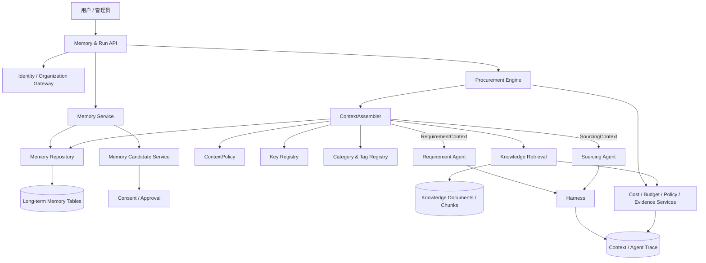
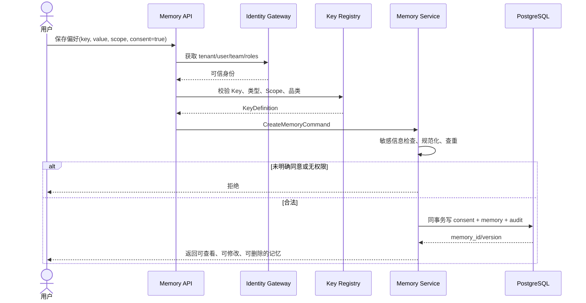
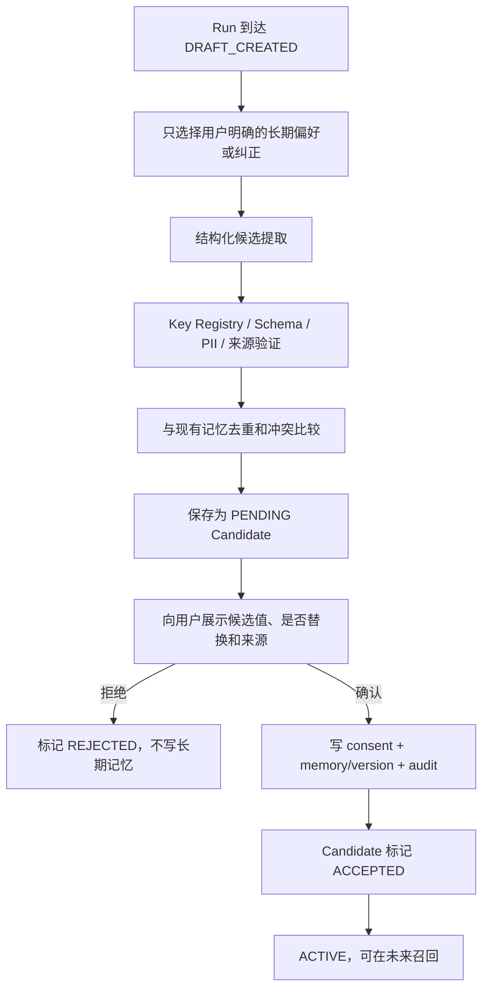
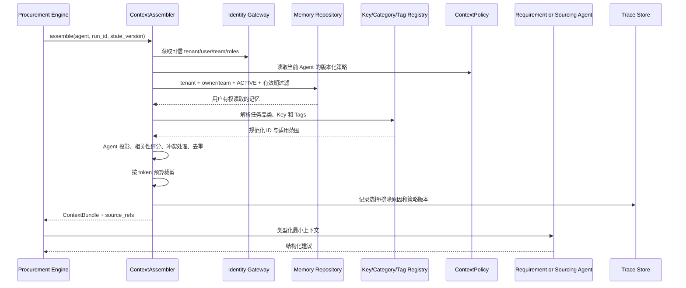
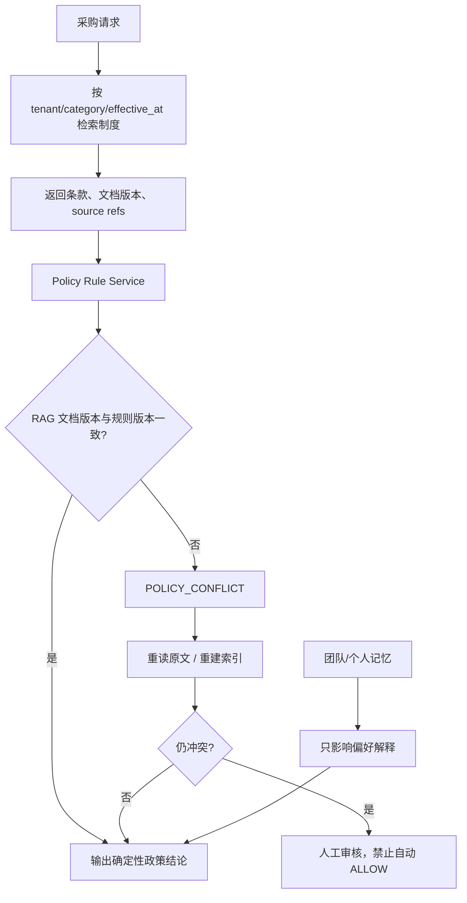
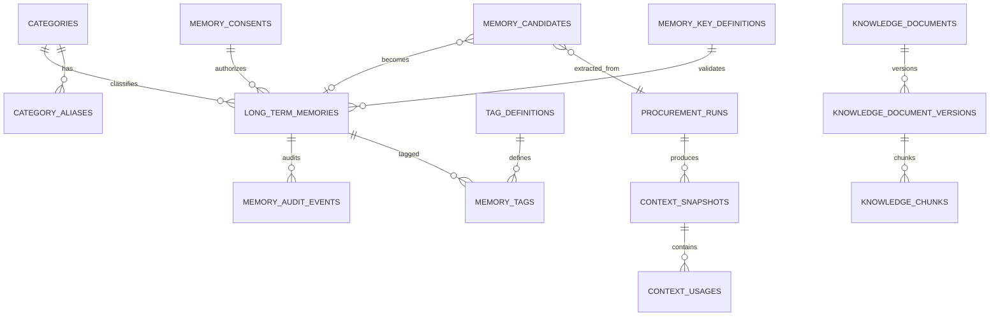

# 记忆、上下文与知识检索模块技术设计

> 版本：v1.4
> 日期：2026-09-09
> 状态：M2.1、M2.2、M2.3，以及 M3 FTS + pgvector + RRF 混合检索最小纵向切片已实现
> 适用组件：Long-term Memory、ContextAssembler、Requirement Agent、Sourcing Agent、Knowledge Base/RAG

## 1. 文档目的

本模块解决四个问题：

1. 系统应该长期保存什么，不能保存什么；
2. 不同用户和不同 Agent 分别能看到什么；
3. 如何从大量消息、记忆和企业知识中选出与当前任务相关的最小上下文；
4. 如何保证历史偏好不会覆盖本次要求、实时事实和当前制度。

记忆模块不是“把历史聊天全部发送给模型”。它是一条受权限、来源、版本、有效期、相关性和 token 预算约束的数据管线。

## 2. 当前实现与目标差距

### 2.1 当前已经实现

- PostgreSQL/SQLite 下的 `long_term_memories`；
- `PROFILE`、`TEAM`、`EPISODIC`、`SEMANTIC` 四种历史 Scope；
- `tenant_id`、所有者、团队、状态组成的可见性过滤；
- 创建时要求 `consent_acknowledged=true`；
- 个人和团队读取边界；
- 只有创建者可以修改、删除；
- `lock_version` 乐观锁；
- 软删除正文清除；
- 不复制记忆正文的生命周期审计；
- 普通 API 禁止创建 `SEMANTIC`；
- `ContextPolicy v1` 由版本控制配置加载，不由用户或模型修改；
- `ContextAssembler` 是两个 Agent 获取数据库记忆的唯一入口；
- Repository 先做 tenant/user/team/status 权限过滤，Assembler 再做 Agent Key/Scope 投影；
- 已实现同 Key 基础去重与冲突优先级、本次明确输入优先；
- 已按 Agent 上限和 Harness 剩余输入 token 装箱，旧消息可裁剪，当前消息保留；
- 已将最小 Context 放入 `AgentTaskEnvelope`，Trace 不记录记忆正文；
- Key、Category、Alias 和 Tag 来自版本化受控 Registry，用户和模型不能发布定义；
- 结构化值写入前按 Key Schema、Scope 和品类校验；
- 已增加定义版本、稳定品类 ID、正式 Tag ID、有效期、置信度和 metadata；
- Consent 与记忆在同一事务写入，重复请求由请求 ID 和命令指纹保护；
- 普通员工不能写 TEAM 记忆；新确认值会将旧值标记为 `SUPERSEDED`；
- 已完成上下文、Registry、候选确认和制度混合检索专项测试，总后端回归为 111/111。
- 已建立独立 Knowledge Document/Version/Chunk 表和 Alembic `20260909_0006`；
- 已实现原文哈希、页码噪声清理、标题/编号条款优先切块和 CJK unigram/bigram 索引文本；
- 已实现治理角色导入/发布/重建索引 API，以及 tenant/category/effective/version 过滤；
- PostgreSQL 使用 `to_tsvector('simple', search_text)` GIN 索引，SQLite 提供测试兼容路径；
- 检索返回条款级版本化引用，Engine 在推荐与确认前校验引用版本与 Policy-as-Code；
- 已实现 PostgreSQL `vector(256)`、HNSW cosine 索引、FTS/vector 双路 Top-K、RRF（k=60）和确定性重排；
- 每条引用返回 FTS/vector rank、RRF、向量相似度、重排分与召回通道；向量生成失败降级 FTS；
- 5 条 fixture 标签已计算 Hit@3、MRR、无答案准确率与双路信号覆盖率。
- 已发布知识库无答案、无有效版本或版本冲突时安全停止；未启用知识库的租户兼容既有规则引用。

### 2.2 当前尚未实现

- 默认 embedding 是离线哈希 n-gram 基线，没有接真实语义 embedding 或 cross-encoder rerank；
- 没有 PDF/DOCX、复杂表格和扫描件 OCR ingestion；
- 没有大规模真实制度 holdout 上的 Recall@K、MRR、citation precision/recall 基线；
- 没有物理清除、缓存/向量副本删除和保留期任务；
- Registry 当前是受版本控制的 YAML，还没有接企业 PIM/ERP 同步表；Tag 当前保存为正式 ID 数组，尚未拆成关联表。

本文后续描述的是目标设计，不应被理解为以上能力已经完成。

## 3. 核心原则

### 3.1 数据分层

```text
Working Context
  本次 Run 的需求、消息、工具结果和状态；随 Run 结束，不是长期记忆

Long-term Memory
  用户偏好、团队标准、经确认的历史经验

Knowledge Base
  制度原文、版本、条款、设备标准和供应商知识；由治理流程发布

Live Enterprise Facts
  当前预算、人员角色、供应商状态、价格、库存和交付；每次实时读取
```

四层不能互相替代。特别是：历史记忆不能代替实时预算，RAG 片段不能直接代替 Policy-as-Code 的最终决定。

### 3.2 权限先于相关性

```text
可进入候选集
= 用户有权读取
AND 当前 Agent 允许看到该数据类型
AND 数据当前有效
AND 数据与任务相关
```

无权限的数据不会因为向量相似度高而被召回。

### 3.3 建议与决定分离

- 模型可以生成记忆候选，不能直接写长期记忆；
- 模型可以识别品类别名，不能发布新 Category；
- 模型可以提出新 Key/Tag，不能修改 Registry；
- RAG 可以找到制度条款，Policy Rule Service 决定 `ALLOW/DENY`；
- Agent 可以使用偏好提出候选，Engine 再校验成本、预算、制度和证据。

### 3.4 当前输入优先

偏好冲突时：

```text
本次用户明确输入
> 当前有效团队标准
> 用户已确认长期偏好
> 历史经历
```

合规冲突时：

```text
当前生效的制度原文和 Policy-as-Code
> 实时企业事实
> 团队记忆
> 个人记忆
> 历史经历
```

用户可以覆盖偏好，不能通过对话或记忆覆盖公司制度。

## 4. 总体架构



`ContextAssembler` 是唯一允许为 Agent 组装数据库上下文的入口。Agent 不直接查询记忆表或知识库。

## 5. 业务流程

### 5.1 用户手工保存个人偏好



### 5.2 从采购历史生成记忆候选



候选提取器是受 Schema 约束的模型调用或规则服务，不是拥有写权限的第三个 Agent。

### 5.3 为不同 Agent 组装上下文



### 5.4 制度 RAG 与记忆冲突



制度文档属于 Knowledge Base，不再新增为 `long_term_memories.SEMANTIC`。历史 `SEMANTIC` 数据应通过迁移进入知识库或标记停用。

## 6. 领域对象设计

### 6.1 MemoryKeyDefinition

Key Registry 规定系统允许记住什么，而不是保存某个用户的值。

```text
key                         procurement.category.preferred_brand
definition_version          3
value_schema                JSON Schema
allowed_scopes              [PROFILE, TEAM]
applicable_categories       [CAT-COMPUTER-LAPTOP, ...]
applies_to_agents           [SOURCING]
requires_confirmation       true
sensitivity                 LOW | PERSONAL | RESTRICTED
merge_strategy              REPLACE | SET_UNION | KEEP_LATEST | MANUAL
default_ttl_days             nullable
status                      ACTIVE | DEPRECATED
```

正式 Key 来自产品需求、企业 PIM/ERP 字段、品类属性字典和经过评测的失败模式。模型只能提出候选 Key，由产品/数据负责人审核后发布新版本。

推荐命名：

```text
procurement.<category-or-category>.<attribute>
team.device_standard.<profile>
```

示例：

```text
procurement.category.preferred_brand
procurement.category.preferred_warranty_months
procurement.default.delivery_preference
team.device_standard.developer_laptop
```

品类不要嵌入最终数据库主键值；`category` 是模板占位符，实际关联使用稳定 `category_id`。

### 6.2 CategoryDefinition 与 CategoryAlias

```text
CategoryDefinition
  category_id                CAT-COMPUTER-LAPTOP
  code                       computer.laptop
  parent_id                  CAT-COMPUTER
  localized_names            {zh-CN: 笔记本电脑, en-US: Laptop}
  source_system              PIM | ERP | UNSPSC | INTERNAL
  source_version
  status

CategoryAlias
  alias_id
  category_id
  locale
  alias_normalized           notebook / 笔记本
  alias_type                 SYNONYM | PROVIDER_CODE | USER_TERM
  confidence
  reviewed
```

品类主数据优先从企业 PIM/ERP 同步，再映射外部标准和项目补充项。别名允许多对一；同一词映射多个品类时结合父类、供应商分类、规格和上下文判断。低置信度必须追问或进入人工审核，不能静默归类。

### 6.3 TagDefinition 与 MemoryTag

```text
TagDefinition
  tag_id                     TAG-WARRANTY-PRIORITY
  code                       warranty-priority
  aliases                    [重视保修, 三年保修优先]
  applicable_categories
  status
  definition_version

MemoryTag
  memory_id
  tag_id
  source                     USER | RULE | MODEL_CANDIDATE | IMPORT
  confidence
  reviewed
```

正式 Tag 来自受控 Tag Registry。规则或模型可以从内容中产生 Tag 候选，再通过 alias canonicalizer 映射为 `tag_id`。无法映射的自由 Tag 不直接进入正式索引。

Tags 用于：

- 在向量/全文检索前做结构化过滤；
- 判断记忆是否与当前任务特征相符；
- 作为相关性排序信号；
- 生成可解释的召回理由。

Tags 不授予权限，也不能覆盖 `tenant_id/scope/owner/team`。

### 6.4 LongTermMemory 目标字段

在现有字段上增加：

```text
memory_id                    已实现
tenant_id                    已实现，安全边界
owner_user_id                已实现
team_id                      已实现
scope                        PROFILE | TEAM | EPISODIC
memory_key                   已实现，并由 Registry 校验
key_definition_version       已实现
category_id                  已实现，可空兼容历史数据；新 API 必填
content                      已实现，人类可读摘要
value_json                   已实现，程序可用的结构化值
tags                         已实现，保存正式 Tag ID 数组
source_ref                   已实现
consent_id                   已实现，并关联同事务创建的 consent 记录
confidence                   已实现，0..1，不参与授权
effective_at                 已实现
expires_at                   已实现
metadata                     已实现，JSONB
status                       ACTIVE | DELETED | SUPERSEDED
lock_version                 已实现
created_at/updated_at        已实现
deleted_at                   已实现
```

`content` 保存简短、可展示、可复用的结论，不保存完整聊天、隐藏推理、Token、实时预算或实时报价。

结构化偏好同时保存 `value_json`：

```json
{
  "memory_key": "procurement.category.minimum_ram_gb",
  "category_id": "CAT-COMPUTER-LAPTOP",
  "content": "采购开发笔记本时最低使用 32GB 内存。",
  "value_json": {"value": 32, "unit": "GB"}
}
```

### 6.5 MemoryCandidate

```text
candidate_id
tenant_id
owner_user_id
origin_run_id
scope                       当前自动提取固定为 PROFILE
memory_key
key_definition_version
category_id
proposed_content
proposed_value_json
source_message_refs
source_ref
confidence
dedup_target_memory_id
conflict_type
status                      PENDING | ACCEPTED | REJECTED | EXPIRED
expires_at
created_at/resolved_at
```

候选不是长期记忆，不能进入 Agent 上下文。

### 6.6 MemoryConsent

```text
consent_id
tenant_id
user_id
purpose
displayed_text
memory_key
scope
policy_version
accepted_at
revoked_at
request_id
```

当前 `consent_acknowledged=true` 只能证明一次 API 声明。目标表用于证明用户看到了什么、同意了什么用途，以及何时撤回。

### 6.7 ContextSnapshot 与 ContextUsage

为回放和审计保存“当时给模型看了什么的引用”，正文可按保留策略选择保存或只保存 hash。

```text
ContextSnapshot
  context_id
  tenant_id/run_id/state_version
  agent_kind
  context_policy_version
  model
  input_token_budget
  estimated_tokens
  content_hash
  created_at

ContextUsage
  context_id
  source_type                MESSAGE | MEMORY | KNOWLEDGE | REQUIREMENT
  source_id
  source_version
  selected
  exclusion_reason
  relevance_score
  token_count
```

## 7. 数据库目标关系



关键索引和约束：

- 所有业务查询的首列必须包含 `tenant_id`；
- `ACTIVE` 记忆按 `tenant/scope/owner/team/category/key` 建部分索引；
- `memory_key + key_definition_version` 必须能找到定义；
- `category_id/tag_id` 使用外键；
- consent 的 tenant/user 必须与记忆一致；
- `source_message_ids` 必须属于同 tenant 的 origin Run；
- 同一确认请求使用 `request_id` 唯一约束实现幂等；
- Knowledge 文档使用 `tenant/document/version` 唯一约束；
- 向量索引不能绕过关系型权限过滤。

## 8. 权限设计

### 8.1 权限来源

| 权限值 | 可信来源 |
|---|---|
| tenant/user | 生产 SSO/JWT；当前 fixture session 映射 |
| team/department/roles | 企业身份与组织 Gateway |
| owner/team/scope/status | Memory 数据库列 |
| Agent 可见字段 | 版本化 ContextPolicy |
| Agent 工具 | 代码中的 Agent allowlist |
| 用户工具权限 | Harness Tool Registry |
| 写权限 | 角色 + 状态 + consent/confirmation + 幂等键 |

Prompt、用户自报角色、模型输出、Tag 和相似度都不能授予权限。

### 8.2 Scope 规则

```text
PROFILE / EPISODIC:
  tenant_id == identity.tenant_id
  AND owner_user_id == identity.user_id

TEAM:
  tenant_id == identity.tenant_id
  AND team_id == identity.team_id

TEAM 写入:
  roles intersects {TEAM_ADMIN, PROCUREMENT_SPECIALIST, MEMORY_STEWARD}
  或进入团队标准审批流
```

目标实现建议在 Repository 查询、数据库 RLS 和 Service command validation 三层重复关键约束。

### 8.3 Agent 数据投影

| 数据 | Requirement Agent | Sourcing Agent |
|---|---:|---:|
| 当前需求 | 必须 | 必须 |
| 缺失字段 | 必须 | 不提供 |
| 最近相关消息 | 最多 6 条 | 最多 3 条 |
| 团队设备标准 | 提供 | 提供 |
| 用户默认值 | 提供 | 与选品相关时提供 |
| 品牌/保修/交付偏好 | 必要时 | 提供 |
| Episodic 决策经验 | 通常不提供 | 最多 2 条 |
| 实时预算余额 | 禁止 | 禁止 |
| 完整制度原文 | 禁止 | 禁止 |
| Action Token/幂等键 | 禁止 | 禁止 |

## 9. 相关内容选择算法

### 9.1 阶段一：硬过滤

按照以下顺序执行：

1. tenant；
2. owner/team/scope；
3. `status=ACTIVE`；
4. `effective_at <= now`；
5. `expires_at IS NULL OR expires_at > now`；
6. Key 未废弃且允许当前 Agent；
7. category 是当前品类、父级或 `general`；
8. sensitivity 符合当前用途。

任一失败立即排除并记录原因，不参与评分。

### 9.2 阶段二：任务相关性

初始可解释评分：

```text
score = 0.40 * task_match
      + 0.25 * category_or_key_match
      + 0.20 * authority
      + 0.10 * recency
      + 0.05 * confidence
```

权重不来自模型，也不允许用户修改。它们来自版本控制中的 `context_policy.yaml`，通过固定回归集、holdout、token、延迟和泄漏评测后发布新版本。

`authority` 仅表示信息来源优先级，不是授权：团队正式标准高于个人历史经验；没有权限的数据仍不会进入评分。

向量相似度接入后可以成为 `task_match` 的组成部分，但不能成为唯一依据。

### 9.3 阶段三：冲突与去重

- 同 Key、同 Category、同值：保留较新且来源更强的一条；
- 同 Key、不同值：按权威顺序选择，并把冲突写入 Trace；
- 本次明确输入与记忆冲突：使用本次输入；
- 团队标准与个人偏好冲突：硬标准使用团队值，软偏好允许个人值；
- 记忆与制度冲突：制度胜出，必要时停止自动推荐；
- 不可判定冲突：不给 Agent 两条互相矛盾的无标记文本，进入人工确认。

### 9.4 阶段四：token 裁剪

```text
usable_context_tokens = min(
    model_input_limit,
    harness_remaining_input_tokens,
    agent_context_limit
) - system_prompt_tokens
  - tool_schema_tokens
  - output_reserve_tokens
  - safety_margin_tokens
```

装箱顺序：

1. 当前结构化需求；
2. 当前用户明确输入；
3. 当前阶段必要字段；
4. 有效团队硬标准；
5. 已确认个人偏好；
6. Episodic 经验；
7. 低优先级历史消息。

不能通过截断破坏金额、单位、否定词或 evidence ref。若一条结构化项放不下，整条排除并记录 `TOKEN_BUDGET_EXCEEDED`。

## 10. ContextPolicy 配置

建议新增版本化配置，而不是把核心权重放进任意可修改数据库表：

```yaml
version: context-policy-v1

global:
  safety_margin_tokens: 512
  output_reserve_tokens: 1200
  reject_unconfirmed_candidates: true

agents:
  REQUIREMENT:
    max_context_tokens: 5000
    max_recent_messages: 6
    max_profile_memories: 2
    max_team_memories: 3
    max_episodic_memories: 0
    allowed_key_prefixes:
      - procurement.category.minimum_
      - procurement.default.
      - team.device_standard.

  SOURCING:
    max_context_tokens: 7000
    max_recent_messages: 3
    max_profile_memories: 4
    max_team_memories: 3
    max_episodic_memories: 2
    allowed_key_prefixes:
      - procurement.category.preferred_
      - procurement.default.delivery_
      - team.device_standard.

ranking:
  task_match: 0.40
  category_or_key_match: 0.25
  authority: 0.20
  recency: 0.10
  confidence: 0.05
```

全局模型请求/token/费用硬上限继续由 Harness `ExecutionBudget` 和环境配置提供。ContextPolicy 只能进一步收紧，不能突破 Harness 上限。

## 11. Agent 上下文契约

### 11.1 公共引用结构

```python
class ContextItem:
    source_type: Literal["MESSAGE", "MEMORY", "KNOWLEDGE", "REQUIREMENT"]
    source_id: str
    source_version: int | str
    key: str | None
    category_id: str | None
    value: dict | str
    source_ref: str
    authority: str
    relevance_score: float
```

### 11.2 RequirementContext

```python
class RequirementContext:
    run_id: str
    state_version: int
    requirement: ProcurementRequirement
    missing_fields: list[str]
    recent_messages: list[MessageView]
    authorized_defaults: list[ContextItem]
    team_standards: list[ContextItem]
    context_policy_version: str
```

### 11.3 SourcingContext

```python
class SourcingContext:
    run_id: str
    state_version: int
    requirement: ProcurementRequirement
    preferences: list[ContextItem]
    team_standards: list[ContextItem]
    episodic_lessons: list[ContextItem]
    context_policy_version: str
```

预算、Policy 最终决定、Action Token 和数据库权限字段不能出现在这两个契约中。

## 12. 核心接口

```python
class MemoryRepositoryPort(Protocol):
    def list_visible(
        self,
        identity: IdentityContext,
        *,
        now: datetime,
        scopes: set[MemoryScope],
    ) -> list[LongTermMemory]: ...

    def create_confirmed(
        self,
        command: CreateConfirmedMemory,
        *,
        request_id: str,
    ) -> LongTermMemory: ...


class ContextAssemblerPort(Protocol):
    async def assemble(
        self,
        *,
        agent: AgentKind,
        run: ProcurementRun,
        identity: IdentityContext,
    ) -> ContextBundle: ...


class MemoryCandidateServicePort(Protocol):
    async def propose(self, run: ProcurementRun) -> list[MemoryCandidate]: ...
    def accept(self, candidate_id: str, consent: ConsentCommand) -> LongTermMemory: ...
    def reject(self, candidate_id: str, identity: IdentityContext) -> None: ...
```

## 13. 关键伪代码

### 13.1 可见性查询

```python
def list_visible_memories(identity, now):
    return db.query(LongTermMemory).where(
        memory.tenant_id == identity.tenant_id,
        memory.status == "ACTIVE",
        memory.effective_at <= now,
        or_(memory.expires_at is None, memory.expires_at > now),
        or_(
            and_(
                memory.scope in {"PROFILE", "EPISODIC"},
                memory.owner_user_id == identity.user_id,
            ),
            and_(
                memory.scope == "TEAM",
                memory.team_id == identity.team_id,
            ),
        ),
    )
```

### 13.2 ContextAssembler

```python
async def assemble_context(agent, run, identity):
    policy = context_policy.for_agent(agent)

    # 第一道安全边界：Repository 只返回有权读取的数据。
    visible = memory_repository.list_visible(identity, now=clock.now())

    category = category_resolver.resolve(
        requirement=run.requirement,
        allow_ambiguous=False,
    )

    candidates = []
    exclusions = []
    for memory in visible:
        definition = key_registry.get(memory.memory_key, memory.key_definition_version)

        reason = hard_filter_reason(
            memory=memory,
            definition=definition,
            agent=agent,
            category=category,
            policy=policy,
        )
        if reason:
            exclusions.append((memory.memory_id, reason))
            continue

        score = relevance_score(memory, definition, run, category, policy.ranking)
        candidates.append(ScoredMemory(memory=memory, score=score))

    resolved = conflict_resolver.resolve(
        current_requirement=run.requirement,
        memories=sorted(candidates, key=lambda x: x.score, reverse=True),
    )

    fixed = build_required_context(agent=agent, run=run)
    bundle = token_packer.pack(
        fixed=fixed,
        optional=resolved,
        max_tokens=calculate_context_budget(agent, run, policy),
    )

    trace_context_selection(
        run=run,
        agent=agent,
        policy_version=policy.version,
        selected=bundle.source_refs,
        excluded=exclusions + bundle.token_exclusions,
    )
    return bundle
```

### 13.3 相关性评分

```python
def relevance_score(memory, definition, run, category, weights):
    signals = {
        "task_match": task_match(memory, run),
        "category_or_key_match": category_key_match(memory, definition, category),
        "authority": authority_score(memory.scope, memory.source_ref),
        "recency": recency_decay(memory.updated_at),
        "confidence": memory.confidence,
    }
    return sum(weights[name] * signals[name] for name in weights)
```

`task_match` 后续可以组合关键词、Tag、FTS 和 embedding，但必须保留各信号明细供 Trace 解释。

### 13.4 token 装箱

```python
def pack_context(fixed, optional, max_tokens):
    selected = list(fixed)
    used = token_count(selected)

    if used > max_tokens:
        raise ContextBudgetError("Required context exceeds the Agent limit")

    for item in optional:
        item_tokens = token_count(serialize_whole_item(item))
        if used + item_tokens > max_tokens:
            record_exclusion(item, "TOKEN_BUDGET_EXCEEDED")
            continue
        selected.append(item)
        used += item_tokens

    return ContextBundle(items=selected, estimated_tokens=used)
```

### 13.5 历史经历压缩与候选生成

```python
async def propose_memories_from_run(run, identity):
    assert run.state == DRAFT_CREATED

    # 第一版只读 user 消息，只接受“以后/默认/记住”等明确长期表达。
    # 助手建议、“这次”要求和含凭证/PII 的句子直接跳过。
    proposals = conservative_extractor.extract(
        user_messages=run.messages,
        allowed_keys=key_registry.active_keys(),
    )

    accepted_candidates = []
    for proposal in proposals:
        validate_source_messages_belong_to_run(proposal, run)
        definition = key_registry.validate_value(proposal.key, proposal.value_json)
        pii_scanner.reject_forbidden_content(proposal)
        comparison = compare_with_existing_memory(proposal, identity)

        if comparison.is_exact_duplicate:
            continue

        accepted_candidates.append(
            candidate_repository.create_pending(
                proposal=proposal,
                dedup_target=comparison.target_id,
                conflict_type=comparison.conflict_type,
                expires_at=clock.now() + timedelta(days=14),
            )
        )
    return accepted_candidates
```

未来若增加模型提取器，只替换 `conservative_extractor` 的实现。模型仍然只能返回受 Schema 约束的 proposal，后续来源、PII、Registry、重复、冲突和用户确认步骤保持不变。

### 13.6 用户确认候选

```python
def accept_memory_candidate(candidate_id, identity, confirmation, request_id):
    candidate = candidate_repository.get_for_update(candidate_id, identity.tenant_id)
    assert candidate.owner_user_id == identity.user_id
    assert candidate.status == "PENDING"
    assert candidate.expires_at > clock.now()
    assert confirmation.displayed_text == candidate.proposed_content

    current = find_active_memory(candidate.key, candidate.category_id, identity)
    assert optional_id(current) == candidate.dedup_target_memory_id

    definition = key_registry.validate_value(
        candidate.memory_key,
        candidate.proposed_value_json,
    )
    authorize_scope_write(identity, candidate.scope, definition)
    assert confirmation.displayed_text == candidate.proposed_content
    assert current_target_memory_id(candidate) == candidate.dedup_target_memory_id

    with transaction():
        consent = consent_repository.create_idempotent(
            request_id=request_id,
            user_id=identity.user_id,
            displayed_text=confirmation.displayed_text,
            purpose="LONG_TERM_PERSONALIZATION",
            policy_version=confirmation.policy_version,
        )
        memory = memory_repository.upsert_by_merge_strategy(
            candidate=candidate,
            consent_id=consent.consent_id,
            definition=definition,
        )
        candidate_repository.mark_accepted(candidate, memory.memory_id)
        audit_repository.append("MEMORY_ACCEPTED", before=None, after=metadata_only(memory))
    return memory
```

### 13.7 RAG 与政策一致性

```python
def evaluate_policy_with_knowledge(query, identity, purchase_date):
    fts_hits = knowledge_retriever.search_fts(
        tenant_id=identity.tenant_id,
        query=query,
        effective_at=purchase_date,
        status="PUBLISHED",
    )
    vector_hits = knowledge_retriever.search_vector(
        tenant_id=identity.tenant_id,
        query_embedding=embedding_provider.embed(query),
        effective_at=purchase_date,
        status="PUBLISHED",
    )
    chunks = deterministic_rerank(rrf(fts_hits, vector_hits, k=60))
    verified = verify_chunk_sources_and_versions(chunks)
    rule_result = policy_rule_service.evaluate(query, identity)

    if verified.policy_version != rule_result.policy_version:
        trace("POLICY_CONFLICT", verified.version, rule_result.policy_version)
        raise HumanReviewRequired("Knowledge index and executable policy disagree")

    return PolicyExplanation(
        decision=rule_result.decision,
        reasons=rule_result.reasons,
        citations=verified.source_refs,
    )
```

## 14. 写入、更新、删除和撤回

### 14.1 写入

- PROFILE/EPISODIC 必须由当前用户明确确认；
- TEAM 必须由允许角色创建或通过团队审批；
- 所有写入要求 `request_id` 幂等；
- `content` 和 `value_json` 必须同时通过 Key Schema；
- Audit 只保存必要元数据，不复制敏感正文。

### 14.2 更新

- 客户端提交 `expected_version`；
- 数据库 `WHERE lock_version = expected_version`；
- 冲突返回 409，禁止旧页面覆盖新值；
- 重大含义变化建议重新确认 consent。

### 14.3 删除与撤回

```text
用户删除/撤回
→ 主记录立即不可召回
→ 正文清除或加密擦除
→ FTS/向量索引删除
→ Context 缓存失效
→ 未完成 Candidate 取消
→ 保存最小审计
→ 到达保留期限后物理清除
```

备份清除时限需要写入数据保留政策，不能只删除主表。

## 15. API 设计

M2.2 已增加：

```text
GET    /api/memory-definitions
GET    /api/categories?query=
GET    /api/memory-tags
GET    /api/memories/{id}/consent
```

M2.3 已增加：

```text
GET    /api/memory-candidates
POST   /api/runs/{run_id}/memory-candidates
POST   /api/memory-candidates/{id}/accept
POST   /api/memory-candidates/{id}/reject
```

M3 及之后目标增加：

```text
POST   /api/memories/{id}/revoke-consent
GET    /api/runs/{run_id}/context-usages

POST   /internal/knowledge/documents
POST   /internal/knowledge/documents/{id}/publish
POST   /internal/knowledge/reindex
```

内部知识 API 需要管理员/服务身份，不能复用普通用户记忆创建接口。

## 16. Trace 与可观测性

至少记录：

```text
context.assembly_started
context.memory_selected
context.memory_excluded
context.conflict_resolved
context.token_budget_applied
context.assembly_completed
memory.candidate_created
memory.candidate_accepted/rejected
memory.created/updated/deleted
knowledge.document_published
knowledge.policy_version_conflict
```

Trace detail 应包括 ID、版本、Scope、Key、分数信号和排除原因，不默认记录完整个人正文。

关键指标：

- `memory_recall_selected_count`；
- `memory_recall_permission_rejection_count`；
- `memory_candidate_acceptance_rate`；
- `memory_conflict_rate`；
- `context_tokens_by_agent`；
- `context_truncation_rate`；
- `stale_memory_used_count`，必须为 0；
- `cross_tenant_memory_leak_count`，必须为 0；
- `policy_knowledge_version_conflict_count`。

## 17. 安全与隐私

- 数据库查询必须显式带 tenant，生产再增加 PostgreSQL RLS；
- ContextAssembler 返回最小字段，禁止把数据库 Record 直接序列化给模型；
- memory content、历史消息和制度片段都是不可信文本，不得改变工具权限和系统指令；
- 禁止保存密钥、Token、银行卡、认证 Cookie 和模型隐藏推理；
- PII/敏感字段按 KeyDefinition 的 sensitivity 加密或拒绝；
- Agent 输出不能修改 Scope、owner、team、consent 或 policy version；
- 向量库、缓存、离线数据集必须复用相同 tenant/删除规则；
- 自动提取失败只能失去个性化能力，不能影响采购主闭环；
- RAG 无答案或版本冲突时安全停止，不能让模型补写制度。

## 18. 测试与验收

### 18.1 一票否决

- 跨租户记忆泄漏：0；
- 跨用户 PROFILE/EPISODIC 泄漏：0；
- 未授权 TEAM 写入：0；
- 未确认候选写入长期记忆：0；
- 已删除/过期/未生效记忆进入上下文：0；
- 记忆覆盖本次明确需求：0；
- 记忆或 RAG 覆盖当前 Policy 决定：0；
- 删除后向量/缓存仍可召回：0；
- Agent 上下文包含 Action Token、实时预算余额或越权数据：0。

### 18.2 功能测试

- Key Schema 和 Scope 校验；
- Category alias 多对一、歧义追问和父级回退；
- Tag canonicalization 和未知 Tag 隔离；
- PROFILE/TEAM/EPISODIC 正确进入对应 Agent；
- Requirement/Sourcing 上下文投影不同；
- 当前输入覆盖历史偏好；
- 团队硬标准和个人软偏好冲突处理；
- token 裁剪稳定且不截断结构化条目；
- 候选生成、接受、拒绝、过期和重复确认幂等；
- 新版本替代旧版本，旧版本更新冲突；
- consent 撤回和物理清除任务；
- RAG tenant、版本、生效日期、引用和无答案拒答；
- Context Snapshot 可回放同一选择结果。

### 18.3 评测指标

- Context precision：送入 Agent 的记忆中真正有用的比例；
- Context recall：应该送入的关键记忆被选中的比例；
- Conflict accuracy：冲突优先级判断正确率；
- Candidate acceptance：候选被用户接受率；
- Token efficiency：每次 Agent 调用的有效上下文/token；
- Personalization lift：加入记忆后寻源偏好准确率提升；
- RAG citation precision/recall 和 policy-version consistency。

## 19. 分阶段实施计划

### M2.1：ContextAssembler 最小切片

状态：**已完成（2026-09-08）**。

1. 增加 ContextPolicy v1；
2. 使用现有 `memory_key/content/scope/source_ref/version`；
3. 实现 tenant/owner/team/status 硬过滤；
4. 通过静态 Key prefix 映射两个 Agent；
5. 增加 token 裁剪和 Trace；
6. 将 ContextBundle 接入 `AgentTaskEnvelope`；
7. 完成跨租户和 Agent 投影测试。

这一阶段暂不做 embedding，先证明权限和上下文边界正确。

实现位置：

- `backend/config/context_policy.yaml`：两个 Agent 的上下文上限、Scope 数量和 Key 前缀；
- `backend/src/procure_pilot/services/context.py`：过滤、评分、冲突、裁剪和最小投影；
- `backend/src/procure_pilot/agents/contracts.py`：`AgentContextPayload` 契约；
- `backend/src/procure_pilot/agents/multi_agent.py`：执行前装配和元数据 Trace；
- `backend/tests/test_context_assembler.py`：权限、投影、冲突、预算与 Engine 集成测试。

M2.2 已补充 `effective_at` 和 `expires_at`；当前 Repository 与 ContextAssembler 都会执行时间有效性过滤。

### M2.2：Registry 与结构化记忆

状态：**已完成最小纵向切片（2026-09-08）**。

1. 增加版本化 Key Registry、Category、Alias 和 Tag 定义；
2. 为记忆增加 `value_json/category/key_definition_version/tags/effective/expires/confidence/metadata`；
3. 限制 TEAM 写角色；
4. 增加 Consent 表和查询 API；
5. 实现写入 Schema 校验、幂等、冲突检测和新记录替代旧记录；
6. ContextAssembler 使用 Registry 的适用 Agent 和品类规则。

当前 Registry 使用受版本控制的 `backend/config/memory_registry.yaml`，原因见 [ADR-0011](adr/0011-controlled-memory-registry.md)。这是当前无企业 PIM/ERP 数据源时更容易审核和回滚的实现；生产目标中的 Registry 同步表和 `memory_tags` 关联表仍待后续实现。

实现位置：

- `backend/config/memory_registry.yaml`：正式 Key、品类、别名、Tag 和 Value Schema；
- `backend/src/procure_pilot/services/memory_registry.py`：解析、歧义检测、Schema 和 Tag 标准化；
- `backend/src/procure_pilot/services/memory.py`：Scope 权限、Consent、TTL 和写入编排；
- `backend/migrations/versions/20260908_0003_structured_memory_registry.py`：结构化字段与 Consent 表；
- `backend/tests/test_memory_registry.py`：Registry、权限、幂等、替代、时间过滤和 Agent 投影测试。

### M2.3：记忆候选闭环

状态：**已完成最小纵向切片（2026-09-08）**。

1. 只从 `DRAFT_CREATED` Run 的用户消息选择可引用证据；
2. 通过保守确定性提取器识别明确长期意图，不把“这次”需求或助手建议升级为记忆；
3. 执行凭证/PII、Registry Schema、来源、重复和冲突校验；
4. 候选独立保存，14 天过期，未接受前不进入 Agent Context；
5. 用户可在 API/UI 接受或拒绝；接受后复用 Consent、幂等和版本替代；
6. 候选生成和处理只向 Run Trace 写入 ID、Key、Scope 和状态，不复制个人正文；
7. migration `20260908_0004` 已在真实 PostgreSQL 17 应用并检查表结构和唯一索引。

实现位置：

- `backend/src/procure_pilot/services/memory_candidates.py`：安全终态检查、保守提取、敏感信息过滤、去重、接受和拒绝编排；
- `backend/src/procure_pilot/persistence/memory_candidate_repository.py`：租户/用户隔离、提议幂等、状态转换和过期；
- `backend/migrations/versions/20260908_0004_memory_candidates.py`：候选表、查询索引和唯一约束；
- `backend/src/procure_pilot/api/app.py`：自动/显式提议和候选处理 API；
- `frontend/src/App.tsx`：用户可见的候选确认卡；
- `backend/tests/test_memory_candidates.py`：临时需求、凭证、重复、冲突、跨租户、接受、拒绝、过期和幂等测试。

当前提取器故意偏向少提取，避免误把一次性要求写成长期偏好。后续可以增加模型提取器来覆盖复杂表达，但模型输出仍只能成为候选，并且必须通过相同 Registry 与确认链路。

### M3：独立知识库与制度 RAG（混合检索首片已完成）

1. 建 Knowledge Document/Version/Chunk（已完成）；
2. 将历史 `SEMANTIC` 迁移或停用；
3. FTS + pgvector 双路召回、RRF 和确定性重排（已完成）；
4. tenant/category/effective/version 过滤（已完成）；
5. RAG 引用与 Policy-as-Code 版本一致性（已完成）；
6. 无答案、过期、冲突进入安全停止或人工审核（已完成首片）。
7. PDF/DOCX/OCR、真实 embedding、离线回填与大规模 holdout（待完成）。

### M4：持久化 Context 和生产强化

1. Context Snapshot/Usage；
2. 缓存与删除传播；
3. PostgreSQL RLS；
4. 物理清除与备份保留；
5. Context 策略 canary、评测和回滚。

## 20. 完成定义

记忆模块完成不等于“数据库中能存一段文字”。只有同时满足以下条件才算完成：

```text
用户能看见、确认、修改、删除和撤回
+ 数据有 Key、结构化值、来源、版本和有效期
+ tenant/user/team 权限不可绕过
+ 两个 Agent 获得不同的最小上下文
+ 选择和排除原因可追踪、可回放
+ token 上限稳定执行
+ 当前输入、实时事实和制度永远高于历史记忆
+ 制度知识与用户记忆分库分责
+ 所有 veto 测试持续为 0
```
