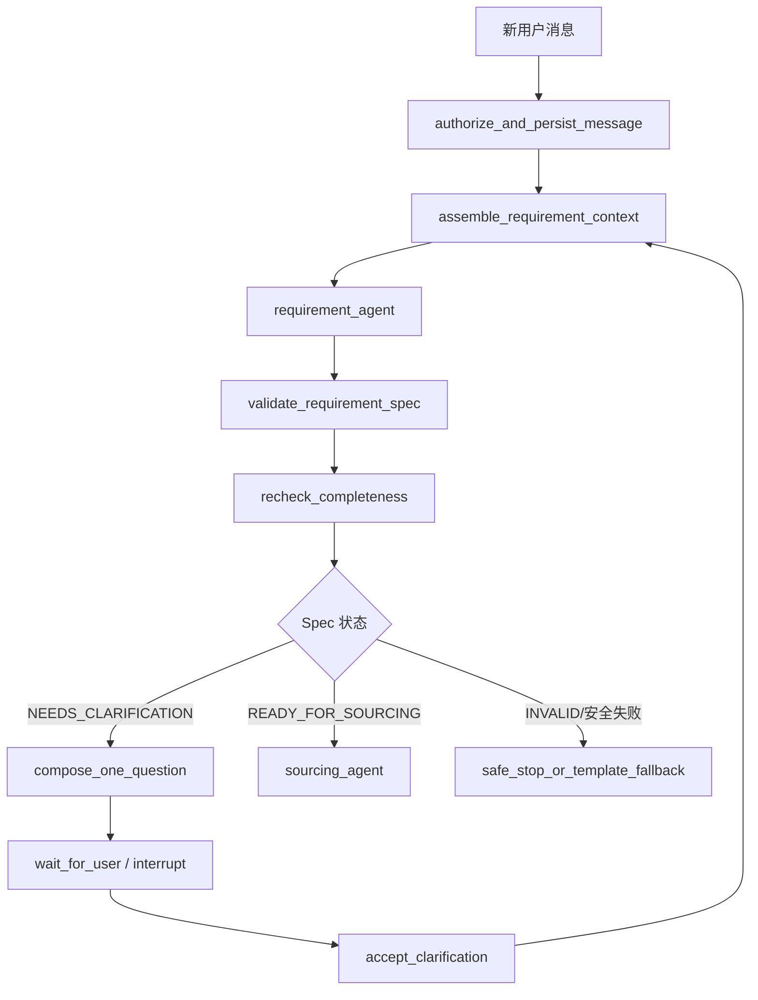

# Requirement Agent 与版本化 RequirementSpec 技术设计

> 2026-10-15 更新：单问题／最多三问策略已由[集中追问与字段解决状态方案](19-agent-expansion-plan.md)替代。下文保留原设计历史；当前问题集合、明确无要求和标准授权规则以新方案及 ADR-0017 为准。

> 版本：v1.1
> 日期：2026-09-11
> 状态：核心链路已实现
> 适用组件：LangGraph Workflow、Requirement Agent、Procurement Engine、ContextAssembler、Tool Gateway、Evaluation

> 实现位置：`domain/requirements.py`、`services/requirement_validation.py`、`agents/multi_agent.py`、`workflow.py`。已包含零工具边界、原文证据、硬软约束、冲突、Top-1 追问、增量、版本历史，以及完整请求强制先经过 Requirement Agent。

## 1. 决策摘要

Requirement Agent 不再调用 `inspect_procurement_requirement` 后复述服务端已有的缺失字段，而成为每条新用户输入进入采购流程后的唯一语义理解角色。

它必须完成八项职责：

1. 识别商品品类、用途、数量和预算；
2. 区分硬约束与软偏好；
3. 识别用户条件之间的冲突；
4. 根据品类 Schema 判断必要字段是否缺失；
5. 每轮只选择一个最影响推荐结果的澄清意图；
6. 根据本轮新输入生成相对上一版本的增量变更；
7. 输出完整、带版本号和来源证据的 `RequirementSpec`；
8. 不访问商品目录，不生成商品/Offer ID，不声明价格、库存等商品事实。

服务端仍是最终业务权威：Agent 输出的是 `authority=PROPOSED` 的完整规格，必须经过 `RequirementSpecValidator` 的版本、Schema、证据、冲突、来源优先级和领域不变量校验，才能保存为 `authority=VALIDATED` 的新版本。

目标调用顺序调整为：

```text
新用户消息
  -> Requirement Agent
  -> RequirementSpec Validator
  -> RequirementCompletenessPolicy
  -> 缺字段/冲突：只追问一个最高影响问题
  -> 完整：Sourcing Agent
```

因此完整请求也会先执行 Requirement Agent，再执行 Sourcing Agent。Graph 不再根据旧的正则抽取结果跳过 Requirement Agent。

## 2. 现状与问题

### 2.1 当前调用链没有让 Agent 理解需求

```text
用户消息
  -> Engine._merge_requirement：正则写入部分字段
  -> Engine._clarification：判断是否完整并生成问题
  -> LangGraph.route_agent：选择 Requirement/Sourcing 节点
  -> TwoAgentPlanner：再次计算缺失字段并再次选择角色
  -> Requirement Agent：调用 inspect_procurement_requirement
  -> Planner：忽略 Agent 返回的 missing_fields，返回固定 AgentPlan
  -> Engine._advance：再次调用 _clarification 并生成最终问题
```

Requirement Agent 没有识别品类、用途、约束、冲突或增量，也没有决定最终追问。模型请求增加了费用和延迟，但没有业务增量。

### 2.2 完整性规则重复并已经产生缺陷

当前至少存在两套必要字段定义：

- `TwoAgentPlanner.REQUIRED_FIELDS` 包含 `minimum_storage_gb`；
- `ProcurementEngine._clarification` 不包含 `minimum_storage_gb`。

可复现输入：

```text
采购20台笔记本，单台预算8000元含税，送到雅加达，两周内，最低32GB内存
```

该输入没有“开发”“Docker”或存储容量，确定性抽取器不会填充存储。Engine 判断需求已完整，随后 `_source_and_recommend` 对存储执行断言并触发 `AssertionError`。

这说明完整性、路由和 Sourcing 前置条件没有共享同一个事实来源。

### 2.3 当前数据模型不能表达完整需求语义

现有 `ProcurementRequirement` 主要保存固定字段，难以表达：

- “必须 32GB”和“最好 32GB”的强度差异；
- “预算最好 8000，最多不能超过 8500”的目标值与上限；
- 用户新输入对上一轮条件的替换、撤销或补充；
- 同一字段在不同消息中的直接冲突；
- 为什么询问某个问题，以及它影响了哪些候选决策。

新 `RequirementSpec` 需要成为可版本化、可解释的需求快照。

## 3. 目标与非目标

### 3.1 目标

1. 每条新用户消息由 Requirement Agent 处理一次，并产生结构化输出；
2. `RequirementSpec` 同时表达核心字段、硬约束、软偏好、冲突、缺失字段和下一问题；
3. 全量 Spec 与增量 Delta 同时输出，既支持业务读取也支持审计；
4. 每个提取事实都有用户消息级证据和置信度；
5. Agent 使用 Registry 提供的品类 Schema 判断缺失，但不能修改 Schema；
6. 每轮最多一个澄清意图，优先解决最影响候选过滤或排序的问题；
7. 所有版本使用 compare-and-swap，陈旧 Agent 结果不可提交；
8. Agent 无工具或仅有非商品型只读能力，永远不能访问目录和商品事实；
9. Agent 失败时可以使用确定性 fallback 安全追问，不越过需求确认。

### 3.2 非目标

- 不搜索商品目录、网页或供应商系统；
- 不返回 SKU、商品 ID、Offer ID、价格、库存、到货承诺或商品推荐；
- 不读取预算余额、供应商状态或最终政策结论；
- 不计算到手成本；
- 不创建采购草稿、不推进审批、不修改工作流状态；
- 不允许模型创建品类、字段、约束运算符或企业默认值；
- confidence 不能替代原文证据与服务端校验。

## 4. 组件职责

| 组件 | 职责 | 不允许做什么 |
|---|---|---|
| Requirement Agent | 语义抽取、硬软分类、冲突识别、缺失判断、Top-1 追问、增量和完整 Spec | 查商品、生成商品事实、写数据库、改状态 |
| RequirementSchemaRegistry | 定义品类、字段、类型、必要性、默认值资格、问题影响权重 | 接受模型在线修改 |
| RequirementSpecValidator | 校验版本、Schema、证据、覆盖优先级、约束和冲突 | 自由补写用户意图 |
| RequirementCompletenessPolicy | 使用同一 Registry 复核 missing/conflict/ready | 自行维护第二套字段列表 |
| ClarificationGuard | 验证 Agent 选择的是当前最高影响澄清意图并限制为一个 | 询问与推荐无关的问题 |
| LangGraph | 固定节点顺序、interrupt、checkpoint 和恢复 | 使用 LLM 路由 |
| Sourcing Agent | 只消费 VALIDATED 且 READY 的 RequirementSpec | 回写或重新解释需求 |

Agent 对缺失字段和问题进行语义判断，服务端复核这些判断是否符合 Registry。两者不是两套需求规则：规则数据只有 Registry 一份，Agent 与 Validator 是不可信执行和可信验证的关系。

## 5. Requirement Schema Registry

### 5.1 字段定义

```python
class RequirementFieldDefinition(BaseModel):
    field_id: str
    value_type: Literal["integer", "money", "boolean", "string", "enum", "duration"]
    applies_to_categories: set[str]
    requirement_level: Literal["ALWAYS", "CONDITIONAL", "OPTIONAL"]
    condition_expression: str | None
    default_constraint_kind: Literal["HARD", "SOFT", "CONTEXT"]
    risk: Literal["LOW", "MEDIUM", "HIGH"]
    decision_impact: float
    may_use_enterprise_default: bool = False
    may_use_memory_default: bool = False
    question_template: str
```

`decision_impact` 是经评测校准的先验权重，不由 Agent 临时生成。示例：

| 字段 | 典型级别 | 影响 |
|---|---|---:|
| category | ALWAYS | 1.00 |
| quantity | ALWAYS | 0.95 |
| budget.maximum | ALWAYS | 1.00 |
| budget.tax_included | CONDITIONAL | 0.80 |
| delivery.location | CONDITIONAL | 0.85 |
| technical.minimum_ram | 品类条件 | 0.90 |
| preferred_brand | OPTIONAL | 0.35 |

具体权重必须通过数据校准，表中数值只用于说明。

### 5.2 品类定义

```python
class CategoryDefinition(BaseModel):
    category_id: str
    names: list[str]
    aliases: list[str]
    required_field_ids: list[str]
    conditional_rules: list[str]
    allowed_hard_constraint_types: list[str]
    allowed_soft_preference_types: list[str]
    schema_version: str
```

Agent 可以根据用户原话选择已有 `category_id`，不能生成新的 ID。不能可靠识别时使用 `UNKNOWN`，并把品类列为最高优先级缺失项。

Registry 首版保存在受版本控制的 `backend/config/requirement_schema.yaml`，后续再接企业采购品类主数据。

## 6. RequirementSpec 数据契约

### 6.1 来源证据

```python
class TextEvidence(BaseModel):
    evidence_id: str
    message_id: str
    start: int
    end: int
    quoted_text: str
```

要求：

- offset 必须准确指向本 Run 的用户消息；
- `quoted_text` 必须与原文片段一致；
- Assistant 消息、工具结果和长期记忆不能伪装成用户证据；
- Trace 默认只保存 message ID、offset 和内容哈希，不复制敏感正文。

### 6.2 核心字段

```python
class SourcedValue(BaseModel):
    value: Any
    normalized_value: Any
    evidence_ids: list[str]
    confidence: float
    source: Literal["CURRENT_INPUT", "PRIOR_CONFIRMED", "ENTERPRISE_DEFAULT", "MEMORY"]

class BudgetRequirement(BaseModel):
    target: SourcedValue | None
    maximum: SourcedValue | None
    currency: SourcedValue | None
    tax_included: SourcedValue | None
```

`RequirementSpec` 至少包含：

- `category`：正式 Category ID 和用户表述；
- `purpose`：研发、办公、设计、差旅等用途；
- `quantity`：数量与单位；
- `budget`：目标/上限、币种和税口径。

数量与预算一旦由用户确认，默认属于硬约束。近似表达如“预算大概 8000”应被表示为软目标或歧义，不得自动转换为绝对上限。

### 6.3 硬约束与软偏好

```python
class RequirementConstraint(BaseModel):
    constraint_id: str
    field_id: str
    operator: Literal["EQ", "NE", "GTE", "LTE", "IN", "NOT_IN", "BEFORE", "AFTER"]
    value: Any
    kind: Literal["HARD", "SOFT"]
    preference_priority: Literal["LOW", "MEDIUM", "HIGH"] | None
    evidence_ids: list[str]
    confidence: float
```

分类规则：

- “必须、至少、最多、不能、两周内”通常为 `HARD`；
- “最好、优先、倾向、如果可以”通常为 `SOFT`；
- 没有语言证据时不得仅凭模型习惯判断强度；
- 企业制度产生的硬门禁不放入用户 RequirementSpec，由 Policy Service 管理；
- 同一条件既有软目标又有硬上限时保存两个约束，例如“最好 8000，最多 8500”。

### 6.4 冲突

```python
class RequirementConflict(BaseModel):
    conflict_id: str
    type: Literal[
        "DIRECT_CONTRADICTION",
        "RANGE_EMPTY",
        "HARD_SOFT_TENSION",
        "NEW_INPUT_OVERRIDES_PRIOR",
        "AMBIGUOUS_REFERENCE",
    ]
    constraint_ids: list[str]
    evidence_ids: list[str]
    blocking: bool
    explanation: str
    resolution: Literal["UNRESOLVED", "OVERRIDDEN_BY_NEW_INPUT", "USER_CONFIRMED"]
```

Requirement Agent 只判断用户条件之间的逻辑或语义冲突。例如：

- “最低 32GB”与“只能买 16GB”是直接冲突；
- “预算不超过 8000”与“预算至少 9000”形成空区间；
- “延续上次配置，但内存改成 64GB”是合法覆盖，不应保留为阻断冲突；
- “必须当天到货且最好价格最低”不是逻辑冲突，而是硬约束与软偏好。

因为 Agent 不访问商品目录，所以它不能声称“市场上没有满足条件的商品”，也不能把商品不可得性当成需求冲突。

### 6.5 增量变更

```python
class RequirementDeltaOperation(BaseModel):
    op: Literal[
        "SET_CORE_FIELD",
        "CLEAR_CORE_FIELD",
        "ADD_CONSTRAINT",
        "UPDATE_CONSTRAINT",
        "REMOVE_CONSTRAINT",
        "ADD_CONFLICT",
        "RESOLVE_CONFLICT",
    ]
    target_id: str
    previous_fingerprint: str | None
    value: Any | None
    evidence_ids: list[str]

class RequirementDelta(BaseModel):
    base_version: int
    proposed_version: int
    source_message_id: str
    operations: list[RequirementDeltaOperation]
```

规则：

- Delta 只描述本轮新输入相对上一版的变化；
- Agent 同时输出完整 Spec，服务端通过重放 Delta 验证完整 Spec；
- `previous_fingerprint` 防止 Agent 基于陈旧值覆盖；
- “改成”“不要了”“还是按原来”必须形成明确操作；
- 无实质字段变化时允许 `operations=[]`，但仍生成处理该消息的新 Spec 版本，确保澄清轮次和下一问题可审计。

### 6.6 缺失字段与单问题

```python
class MissingRequirementField(BaseModel):
    field_id: str
    reason_code: Literal["ABSENT", "AMBIGUOUS", "CONFLICTED", "DEFAULT_REQUIRES_CONSENT"]
    blocking: bool
    decision_impact: float

class ClarificationQuestion(BaseModel):
    question_id: str
    intent_id: str
    field_ids: list[str]
    text: str
    impact_reason: str
    expected_answer_schema: dict[str, Any]
```

“每轮只追问一个问题”按澄清意图计算。一个问题可以覆盖不可分割的字段组，例如：

> 单台最高预算是多少？请同时说明币种以及是否含税。

这仍是一个预算澄清意图，而不是三个互不相关的问题。不得把数量、交付地和内存拼成一轮问卷。

### 6.7 完整 RequirementSpec

```python
class RequirementSpec(BaseModel):
    spec_id: str
    run_id: str
    authority: Literal["PROPOSED", "VALIDATED"]
    schema_version: str
    base_version: int
    version: int
    source_message_id: str

    category: SourcedValue | None
    purpose: SourcedValue | None
    quantity: SourcedValue | None
    budget: BudgetRequirement

    hard_constraints: list[RequirementConstraint]
    soft_preferences: list[RequirementConstraint]
    conflicts: list[RequirementConflict]
    missing_required_fields: list[MissingRequirementField]
    next_question: ClarificationQuestion | None
    delta: RequirementDelta

    status: Literal["NEEDS_CLARIFICATION", "READY_FOR_SOURCING", "INVALID"]
```

版本不变量：

```text
Agent 输出：authority=PROPOSED
base_version == Repository 当前 VALIDATED version
version == base_version + 1
delta.base_version == base_version
delta.proposed_version == version
```

Validator 接受后保存相同 `spec_id/version`，但 authority 改为 `VALIDATED`，并记录校验报告。Agent 不能自行声明其输出已验证。

## 7. Agent 输入与权限

### 7.1 输入 Envelope

```python
class RequirementAgentEnvelope(BaseModel):
    run_id: str
    source_message_id: str
    base_spec: RequirementSpec | None
    new_user_message: str
    recent_user_messages: list[ContextMessage]
    authorized_memories: list[ContextMemoryItem]
    schema_snapshot: RequirementSchemaSnapshot
    clarification_round: int
    max_questions_this_turn: Literal[1] = 1
```

只发送完成任务所需的消息和授权记忆。当前消息不得被历史消息或记忆覆盖。

### 7.2 工具白名单

Requirement Agent 默认工具集合为空：

```python
AGENT_TOOL_ALLOWLIST[AgentKind.REQUIREMENT] = ()
```

Schema Snapshot 作为服务端输入直接放入 Envelope，不通过模型工具读取。这样可以静态证明 Requirement Agent：

- 不能调用 `search_catalog`；
- 不能调用预算、成本或政策工具；
- 不能获得商品 ID、Offer ID、商品价格或库存；
- 不能调用任何写入工具。

Tool Gateway 继续作为第二道保护：即使 Prompt 或 SDK 配置错误，任何未授权工具调用也必须拒绝并记录。

### 7.3 输出禁止字段

RequirementSpec Schema 不提供以下字段：

```text
product_id
variant_id
offer_id
sku
supplier_product_url
quoted_price
stock
catalog_evidence_ref
policy_decision
approval_route
draft_id
```

若模型在自由文本中输出这些内容，Provider Adapter 的严格结构化输出解析应拒绝；不得尝试从额外文本中提取并保存。

## 8. 缺失判断与 Top-1 追问算法

### 8.1 Agent 生成候选判断

Agent 使用 `schema_snapshot` 判断：

- 品类是否已识别；
- ALWAYS 字段是否存在；
- CONDITIONAL 字段条件是否成立；
- 字段是否歧义或冲突；
- 企业默认值是否需要用户授权；
- 当前 Spec 是否可以进入 Sourcing。

### 8.2 服务端复核

`RequirementCompletenessPolicy` 使用同一个 Schema Snapshot 对 Agent 输出进行确定性复核：

```text
canonical_missing = evaluate(validated core fields, constraints, conflicts, schema)
```

如果 Agent 漏报字段，服务端补入并记录 `AGENT_MISSING_FIELD_MISSED`；如果 Agent 多报字段，服务端移除并记录 `AGENT_UNNECESSARY_FIELD_REQUESTED`。最终持久化的是服务端复核后的 `VALIDATED RequirementSpec`。

### 8.3 问题影响排序

对每个未解决澄清意图计算确定性基础分：

```text
impact_score
= Registry.decision_impact
× blocking_multiplier
× conflict_multiplier
× uncertainty_multiplier
× downstream_filter_multiplier
```

其中：

- 阻止进入 Sourcing 的字段优先；
- 能大幅改变候选过滤结果的预算、品类、数量和硬规格优先；
- 解决多个关联字段的单一意图可获得组合收益；
- 纯展示偏好不能排在缺失硬约束之前；
- 已明确字段的分数为零。

Agent 输出 `next_question` 和自然语言理由；`ClarificationGuard` 检查其 `intent_id` 是否属于最高分并列集合。若不是，使用 Registry 模板生成最高分问题并记录 Agent 选择被否决。

### 8.4 问题数量

默认严格执行：

```text
max_questions_this_turn = 1
```

同一 `intent_id` 可以包含紧密耦合字段，例如预算金额、币种与税口径。不同意图不得合并成问卷。该规则需要通过用户测试比较总轮数与单轮认知负担，未来调整必须发布新 Policy 版本。

### 8.5 完整输入示例

用户首轮输入：

```text
给设计团队采购20台笔记本，用来剪辑4K视频。单台最好8000元，最多9000元；
必须至少32GB内存，最好64GB，两周内到货。
```

Requirement Agent 应产生类似下面的缩略结果：

```json
{
  "authority": "PROPOSED",
  "base_version": 0,
  "version": 1,
  "category": {"normalized_value": "CAT-COMPUTER-LAPTOP"},
  "purpose": {"normalized_value": "VIDEO_EDITING_4K"},
  "quantity": {"normalized_value": {"amount": 20, "unit": "device"}},
  "budget": {
    "target": {"normalized_value": {"amount": "8000", "currency": "CNY"}},
    "maximum": {"normalized_value": {"amount": "9000", "currency": "CNY"}},
    "currency": {"normalized_value": "CNY"},
    "tax_included": null
  },
  "hard_constraints": [
    {"field_id": "technical.ram_gb", "operator": "GTE", "value": 32},
    {"field_id": "delivery.days", "operator": "LTE", "value": 14}
  ],
  "soft_preferences": [
    {"field_id": "budget.target", "operator": "LTE", "value": 8000},
    {"field_id": "technical.ram_gb", "operator": "GTE", "value": 64}
  ],
  "conflicts": [],
  "missing_required_fields": [
    {"field_id": "technical.storage_gb", "reason_code": "ABSENT"},
    {"field_id": "delivery.location", "reason_code": "ABSENT"},
    {"field_id": "budget.tax_included", "reason_code": "ABSENT"}
  ],
  "next_question": {
    "intent_id": "clarify_minimum_storage",
    "field_ids": ["technical.storage_gb"],
    "text": "用于4K剪辑时，最低存储容量需要多少？"
  },
  "status": "NEEDS_CLARIFICATION"
}
```

示例省略 evidence、confidence、delta 和 hash 字段；真实输出必须完整。这里的关键点是：

- “最好8000”是软目标，“最多9000”是硬上限；
- “必须32GB”是硬约束，“最好64GB”是软偏好；
- Agent 不提供任何笔记本型号、报价或库存；
- 本轮只问影响过滤最大的存储意图，其他缺失字段留到下一轮。

### 8.6 增量更新示例

用户在 `VALIDATED RequirementSpec v1` 后输入：

```text
最低1TB；内存不用64G了，32G就行。预算上限改成8500元含税。
```

Agent 应输出完整 Spec v2，并同时给出：

```json
{
  "base_version": 1,
  "proposed_version": 2,
  "operations": [
    {"op": "ADD_CONSTRAINT", "target_id": "technical.storage_gb", "value": 1024},
    {"op": "REMOVE_CONSTRAINT", "target_id": "soft:technical.ram_gb:gte:64"},
    {"op": "UPDATE_CONSTRAINT", "target_id": "budget.maximum", "value": 8500},
    {"op": "SET_CORE_FIELD", "target_id": "budget.tax_included", "value": true}
  ]
}
```

v2 必须保留 v1 中没有被修改的品类、用途、数量、32GB 硬下限和两周交付要求。下一问题只能从剩余的交付地点等缺失意图中选择一个。

### 8.7 冲突判定示例

| 用户条件 | 结果 |
|---|---|
| “至少32GB，同时不能超过16GB” | `RANGE_EMPTY`，blocking |
| “必须32GB，最好64GB” | 不冲突；一个硬下限、一个软偏好 |
| “之前要64GB，现在改成32GB” | `NEW_INPUT_OVERRIDES_PRIOR`，已解决 |
| “预算最好8000，最高9000” | 不冲突；软目标与硬上限并存 |
| “必须当天到，价格越低越好” | 不冲突；交期硬约束与价格软偏好 |
| “必须买某个不存在的型号” | Requirement Agent 只记录用户字符串约束，不判断型号是否存在 |

## 9. 目标工作流



### 9.1 完整请求

完整请求不会直接路由 Sourcing：

```text
用户完整输入
  -> Requirement Agent 输出 RequirementSpec v1
  -> Validator 保存 VALIDATED v1 / READY_FOR_SOURCING
  -> Sourcing Agent
```

这保证商品品类、用途、硬软约束和来源证据在寻源前已经形成统一快照。

### 9.2 多轮增量

```text
RequirementSpec v1：缺预算
用户补充：单台最多 8000 元，含税
Requirement Agent：Delta(base=1, proposed=2)
Validator：CAS 接受并保存 VALIDATED v2
CompletenessPolicy：仍缺交付地
系统只询问交付地
```

如果 v1 之后已有并发更新，v2 Proposal 因 `base_version` 陈旧而拒绝。系统重新加载最新 Spec 和消息，再生成新的 Proposal；不能把旧 Delta 强行套用。

## 10. 服务与代码边界

建议新增：

```text
backend/src/procure_pilot/domain/requirements.py
  RequirementSpec
  RequirementDelta
  RequirementConstraint
  RequirementConflict
  ClarificationQuestion

backend/src/procure_pilot/services/requirement_schema.py
  RequirementSchemaRegistry
  RequirementSchemaSnapshot

backend/src/procure_pilot/services/requirement_validation.py
  RequirementSpecValidator
  RequirementCompletenessPolicy
  ClarificationGuard

backend/config/requirement_schema.yaml
```

建议调整：

- `workflow.py`：改为每条新用户输入先执行 `requirement_agent`，再根据 VALIDATED Spec 路由；
- `engine.py`：`_merge_requirement` 仅保留为 fallback，不参与正常 Agent 路径；删除 `_clarification` 的局部字段列表；
- `multi_agent.py`：删除 `REQUIRED_FIELDS` 和内部角色判断；Planner 接收 Graph 指定的 stage；
- `contracts.py`：Requirement Agent 输出类型改为 `RequirementSpec`；
- `provider_adapter.py`：严格结构化输出，Requirement Agent 不绑定任何商品工具；
- `tools.py`：从 Agent 暴露面移除 `inspect_procurement_requirement`；
- `context.py`：Requirement Context 增加 Schema Snapshot 和 base Spec，继续实施消息/记忆最小投影；
- `execution_repository`：保存 Agent Proposal、输入指纹、base/version 和 Validator 结果；
- `repository`：新增 versioned requirement specs，或在 Run JSONB 之外建立规范化版本表。

## 11. 持久化与幂等

建议新增 `requirement_specs`：

| 字段 | 说明 |
|---|---|
| tenant_id/run_id/spec_id | 归属与稳定身份 |
| version/base_version | 版本链 |
| authority/status | PROPOSED/VALIDATED 与业务状态 |
| schema_version | 字段规则版本 |
| source_message_id | 触发本版本的用户消息 |
| spec_json/delta_json | 完整快照和增量 |
| input_fingerprint | 幂等复用 |
| validation_json | 接受、修正和拒绝原因 |
| created_at | 审计时间 |

约束：

- `(tenant_id, run_id, version, authority)` 唯一；
- 同一 `source_message_id + base_version + input_fingerprint` 只执行一次 Agent；
- 只有 Validator 可以创建 `VALIDATED` 行；
- Run 当前 `requirement_spec_version` 通过乐观锁推进；
- 重放 Agent execution 时复用已保存 Proposal，不重复产生不同 Delta。

## 12. 安全与失败语义

| 风险 | 处理 |
|---|---|
| Prompt Injection 要求查目录或直接下单 | Agent 无工具；输出 Schema 无商品和写入字段 |
| 模型虚构数量、预算或用途 | 用户事实必须带可定位的用户原文证据 |
| 模型编造商品事实 | 严格 Schema 拒绝额外字段；自由文本不进入业务对象 |
| 把软偏好升级为硬约束 | Validator 检查触发词、上下文与标注规则，低置信时追问 |
| 漏报冲突 | Validator 执行确定性范围/互斥不变量复核 |
| 声称市场无货 | Requirement Agent 没有目录证据，相关字段不在 Schema，拒绝 |
| 使用记忆覆盖本轮输入 | 按来源优先级拒绝覆盖 |
| 陈旧 Proposal | base version 不匹配时拒绝并重跑 |
| Agent 超时/超预算 | 使用确定性 fallback 生成安全 Spec 或追问，不进入不完整 Sourcing |
| Schema 变化 | 旧 Schema Proposal 不可提交；按新 Snapshot 重跑 |

模型生成的 explanation 仅用于可读说明，不能改变结构化判断结果。

## 13. 可观测性

新增 Trace：

| 事件 | 关键字段 |
|---|---|
| `requirement.agent_started` | execution、base version、message ID、schema version |
| `requirement.spec_proposed` | proposed version、category、hard/soft/conflict/missing 数量 |
| `requirement.delta_validated` | operation 数、接受/修正/拒绝数 |
| `requirement.spec_validated` | version、status、canonical missing、unresolved conflicts |
| `requirement.question_selected` | intent、field IDs、impact score、Agent 是否命中 Top-1 |
| `requirement.question_overridden` | Agent intent、canonical intent、reason code |
| `requirement.forbidden_output_rejected` | 字段名或输出类型，不记录敏感正文 |
| `requirement.fallback_used` | timeout/schema/budget/provider reason |

建议指标：

- category accuracy；
- purpose extraction F1；
- quantity/budget normalized accuracy；
- hard/soft classification macro F1；
- conflict precision/recall；
- missing-field precision/recall；
- Top-1 clarification accuracy；
- unnecessary-question rate；
- mean turns to READY；
- delta operation exact match；
- stale proposal rejection rate；
- forbidden tool/output rate；
- Agent fallback rate、token、费用和延迟。

## 14. 测试设计

### 14.1 八项职责验收矩阵

| 职责 | 必测输出 | 主要指标 |
|---|---|---|
| 品类/用途/数量/预算 | 核心 SourcedValue 与证据 | normalized accuracy/F1 |
| 硬软分类 | constraint.kind | macro F1 |
| 冲突识别 | conflicts + blocking | precision/recall |
| 缺失判断 | missing_required_fields | precision/recall |
| Top-1 追问 | next_question.intent_id | Top-1 accuracy、无关问题率 |
| 增量更新 | delta operations | exact match、replay consistency |
| 版本化 Spec | base/version/authority/status | version invariant pass rate |
| 禁止商品能力 | 零工具、零商品字段 | violation 必须为 0 |

### 14.2 单元测试

1. 每个品类 Schema 可以生成稳定的必要字段和影响权重；
2. 缺少任何阻断字段时 `READY_FOR_SOURCING` 不成立；
3. `minimum_storage_gb` 在 Agent Schema、Validator 和 Sourcing 前置条件中一致；
4. Evidence offset、字段类型、范围、币种和单位校验；
5. HARD/SOFT 触发词、近似表达和不确定分类；
6. 直接矛盾、空区间、合法覆盖和非冲突 trade-off；
7. Delta SET/CLEAR/ADD/UPDATE/REMOVE/RESOLVE 重放；
8. current input > prior confirmed > enterprise default > memory；
9. 每轮 `next_question` 最多一个；
10. Agent 输出商品字段或发起工具调用时拒绝。

### 14.3 必须新增的回归用例

```text
输入：采购20台笔记本，单台预算8000元含税，送到雅加达，两周内，最低32GB内存
预期：RequirementSpec 状态 NEEDS_CLARIFICATION；next_question 询问存储；
      不进入 Sourcing，不触发 AssertionError。
```

其他关键用例：

- “给设计团队买一批电脑”——识别用途，品类/数量/预算仍缺失；
- “要 20 台，预算八千左右，最高不能超过 8500”——软目标与硬上限并存；
- “必须 32G，最好 64G”——一个硬下限和一个软偏好；
- “至少 32G，但只能买 16G”——阻断型直接冲突；
- “不要 16G，至少 32G”——否定和下限不得冲突；
- “和上次一样，但送上海，内存改成 64G”——增量覆盖和保留未变字段；
- “预算不知道，先搜商品再说”——不得调用目录，只追问预算意图；
- “推荐 SKU-123，库存 50 台”——作为用户提供的非可信文本保存或忽略，不生成商品事实；
- Agent 返回 `offer_id`——结构化输出校验失败并 fallback；
- Agent 超时——消息已保存，系统生成安全模板问题。

### 14.4 集成和恢复测试

- 完整输入的执行顺序严格为 Requirement Agent -> Validator -> Sourcing Agent；
- 多轮输入每轮只创建一个新的 VALIDATED Spec 版本；
- Graph 节点、Agent execution 和 Spec version 一致；
- Agent 完成后 Worker 退出，恢复时复用相同 Proposal；
- Validator 提交后 Worker 退出，恢复时不创建重复版本；
- 同一消息重放不重复增加 clarification round；
- 跨租户 Spec、message ID 和 evidence ID 全部拒绝；
- Requirement Agent 的 Tool Gateway 白名单为空。

## 15. 验收标准

P0 合入门禁：

1. Requirement Agent 在正常路径中输出完整 `RequirementSpec` 和本轮 `RequirementDelta`；
2. Spec 包含品类、用途、数量、预算、硬约束、软偏好、冲突、缺失字段和单一下一问题；
3. 每个用户事实都有用户消息证据；
4. `RequirementCompletenessPolicy` 是唯一可信完整性实现，不再有 Planner 局部字段表；
5. 完整输入也先经过 Requirement Agent，Planner 不再二次路由；
6. 一轮最多一个澄清意图；
7. Requirement Agent 工具数为 0，商品事实输出违规数为 0；
8. 陈旧、越权或 Schema 不合法的 Spec 100% 被拒绝；
9. Sourcing 只接受 `VALIDATED/READY_FOR_SOURCING` Spec；
10. 缺存储回归用例通过，用户可触发的缺失条件不再使用裸 `assert`；
11. Agent 失败时安全 fallback，不丢消息、不绕过澄清；
12. 专项评测能分别报告八项职责的质量，而不是只检查最终状态。

## 16. 迁移与发布

### 阶段 A：统一 Schema 和版本存储

1. 建立 Requirement Schema Registry；
2. 新增 RequirementSpec/Delta/Constraint/Conflict 类型；
3. 将现有 `ProcurementRequirement` 映射为 `VALIDATED RequirementSpec v0`；
4. Graph、Engine 和 Sourcing 前置条件改用 CompletenessPolicy；
5. 先修复缺存储崩溃。

### 阶段 B：影子 RequirementSpec

1. 每条新消息调用 Requirement Agent 生成 PROPOSED Spec；
2. 不改变当前 Run，只与现有抽取结果比较；
3. 标注八项职责错误类型；
4. 保存 token、费用和延迟；
5. 不允许影子输出进入 Sourcing Context。

### 阶段 C：受控生效

1. Validator 接受合法 Agent Spec 并写新版本；
2. 高风险字段必须具有精确当前输入证据；
3. 低置信硬软分类或冲突进入单问题澄清；
4. Sourcing 只消费 VALIDATED Spec；
5. 任一安全指标恶化时切回 deterministic fallback。

### 阶段 D：清理旧实现

- 删除 `TwoAgentPlanner.REQUIRED_FIELDS`；
- 删除正常路径中的 `_merge_requirement/_clarification`；
- 移除 Requirement Agent 的 `inspect_procurement_requirement` 工具；
- 删除“完整需求直接跳过 Requirement Agent”的边；
- 更新 Trace grader、live eval、README 和架构图。

建议配置：

```text
PROCURE_REQUIREMENT_MODE=deterministic|shadow_agent|agent
PROCURE_REQUIREMENT_SCHEMA_VERSION=requirement-schema-v1
PROCURE_REQUIREMENT_MAX_QUESTIONS_PER_TURN=1
```

回滚只切换 Requirement 模式，不删除已验证的历史 Spec。Sourcing 使用 Run 当前指向的最后一个 VALIDATED Spec。

## 17. 与 Sourcing 的交接契约

Sourcing Agent 只能接收：

```python
class SourcingRequirementEnvelope(BaseModel):
    run_id: str
    requirement_spec_id: str
    requirement_spec_version: int
    requirement_spec_hash: str
    category_id: str
    purpose: str | None
    quantity: int
    budget: BudgetRequirement
    hard_constraints: list[RequirementConstraint]
    soft_preferences: list[RequirementConstraint]
```

交接前置条件：

```text
authority == VALIDATED
status == READY_FOR_SOURCING
missing_required_fields == []
no unresolved blocking conflict
version/hash == Repository current version/hash
```

Sourcing 不接收 Requirement Agent 的自由文本 reasoning，也不能修改 Spec。如果发现工具层事实无法满足要求，只能返回无候选或受控失败，不能降低硬约束。

## 18. 待决问题

1. `purpose` 是单值枚举还是允许主用途与次用途数组；
2. 用户提供的品牌/型号是否属于需求约束，还是非可信商品引用；
3. 哪些 HARD/SOFT 语言模式可由 Validator 确定性验证，哪些必须追问；
4. 对无实质变化的用户回答是否仍保存新 Spec 版本；当前建议保存，以维持消息处理审计；
5. 一个预算澄清意图覆盖金额、币种和税口径是否符合真实用户体验；
6. Requirement Agent 的模型收益必须由消融评测证明，若不能提升八项职责指标则回退为确定性实现。

> 2026-10-16 更新：需求阶段工具边界扩展为制度、历史采购单两个只读查询；生成的外部需求须经用户确认后才能寻源。消息路由和 INTENT 仍无工具。本文原零工具设计为历史背景，以 [ADR 0019](adr/0019-referenced-requirements-and-confirmation.md) 为准。
