# Sourcing Agent 合规候选排序链路技术设计

> 版本：v1.1
> 日期：2026-09-11
> 状态：核心链路已实现
> 适用组件：Sourcing Agent、Catalog、Canonicalization、Cost、Budget & Policy、Recommendation、LangGraph、Evaluation

> 实现位置：`domain/models.py`、`agents/multi_agent.py`、`agents/provider_adapter.py`、`services/engine.py`。`RETRIEVE` 与 `RANK` 使用同一 Sourcing Agent；服务端持久化带 hash、RequirementSpec 和政策版本绑定的 `ValidatedCandidateSet`，排序阶段禁用目录工具，并执行证据、绑定关系和可配置 absolute regret 门禁。

## 1. 决策摘要

当前 Sourcing Agent 在只看到目录单价、交期和规格时提出一个 Offer；Engine 随后计算到手成本与政策，只要该 Offer 真实且通过硬约束，就允许它覆盖确定性综合最优。这使“模型可见信息”和“模型实际决定权”不对称。

重构后 Sourcing 只能从当前 `VALIDATED/READY_FOR_SOURCING RequirementSpec` 开始。它不能接收未校验的 Requirement Agent reasoning，也不能修改品类、用途、数量、预算、硬约束或软偏好。

目标链路调整为：

```text
Sourcing Agent 检索
  -> 服务端归一、成本、预算、政策过滤
  -> 生成 ValidatedCandidateView
  -> Sourcing Agent 对合规候选排序并解释权衡
  -> 服务端执行 evidence、regret、硬约束校验
  -> Recommendation Service 生成结果
```

模型只在合规候选集合内做多目标偏好权衡。最低成本和最快交付始终由服务端计算；模型只能影响 `best_overall`，且必须满足候选集合哈希、证据、偏好依据和最大效用损失门禁。

## 2. 现状与风险

### 2.1 当前流程

```text
Sourcing Agent
  -> search_catalog × 3
  -> 根据 unit_price / delivery / fit 返回一个 offer ID
Engine
  -> 复用目录结果
  -> 计算 landed cost
  -> 执行预算和政策过滤
  -> 计算 deterministic best
  -> 如果 Agent ID 真实且证据合法，则直接覆盖 best_overall
```

### 2.2 信息不对称

Agent Prompt 明确禁止计算最终成本、读取预算或决定政策，但 Agent 的候选仍可以成为“综合最优”。例如：

- 单价较低但运费/税费导致到手总价更高；
- 交付更快但供应商未准入，需要额外审批；
- 满足最低规格但保修差，确定性效用明显更低；
- Agent 依据历史软偏好选择了与本次显式偏好不一致的商品。

现有证据校验只能证明“候选存在且来自本次检索”，不能证明“候选选择合理”。

### 2.3 当前评测无法识别劣质选择

Live smoke 只要求推荐来源为 `agent_validated`，没有预期候选、排序质量或效用损失标签。模型选择任意真实且合规的候选都可能通过。

## 3. 目标与非目标

### 3.1 目标

1. Agent 排序前能够看到完成确定性计算后的最小候选视图；
2. 任何进入模型的候选均已通过规格、预算、制度和证据硬门禁；
3. Agent 输出绑定当前候选集合和 Run 版本，陈旧结果不可应用；
4. Agent 必须说明选择依据来自本次需求或已授权偏好；
5. 服务端限制相对确定性基线的最大效用损失；
6. Agent 失败时安全回退到确定性排序；
7. 不向 Agent 暴露原始预算余额、内部敏感政策正文或写入能力。
8. 所有检索和排序结果绑定 RequirementSpec ID、版本和内容哈希。

### 3.2 非目标

- 不让 Agent计算金额、汇率、税费或折扣；
- 不让 Agent决定 `ALLOW/DENY` 或审批路径；
- 不让 Agent决定最低成本和最快交付标签；
- 不把 Policy Service 重新包装成第三个 Agent；
- 不允许模型扩大 Provider 白名单或创建草稿。

## 4. 目标架构

```mermaid
flowchart LR
    SA1[Sourcing Agent: RETRIEVE] --> CAT[Catalog Tool Gateway]
    CAT --> RAW[Raw Provider Offers]
    RAW --> CAN[Canonicalization & Match Guard]
    CAN --> COST[Landed Cost Service]
    COST --> POL[Budget & Policy Service]
    POL --> SET[Validated Candidate Set]
    SET --> VIEW[Candidate Projection]
    VIEW --> SA2[Sourcing Agent: RANK]
    SA2 --> VAL[Ranking Validator]
    VAL -->|通过| REC[Recommendation Service]
    VAL -->|拒绝/失败| FALLBACK[Deterministic Ranking]
    FALLBACK --> REC
    REC --> HITL[WAITING_CONFIRMATION]
```



`RETRIEVE` 和 `RANK` 是同一个 Sourcing 角色的两个阶段，可以使用同一模型或分别选择模型，但必须产生两个独立 execution 记录。它们不是两个新的 Agent。

### 4.1 检索阶段

当前 P0 的 Provider 集合固定，因此支持两种执行模式：

- `agent_retrieve`：Sourcing Agent 在静态白名单内调用三个目录工具；用于评测工具使用能力；
- `workflow_fanout`：Graph 确定性并发查询所有 Provider；用于低成本或模型降级模式。

两种模式必须进入同一个规范化、成本和政策管线。模型不能通过少查某个来源改变最终事实集合，除非未来业务明确支持带成本的自适应检索计划。

### 4.2 合规候选集合

只有满足以下条件的候选才能进入 `ValidatedCandidateSet`：

```text
MatchDecision == MATCH
AND match_confidence >= 当前门槛
AND 当前规格硬约束满足
AND 库存和交期事实有效
AND 单价与到手成本计算成功
AND 预算规则通过
AND PolicyDecision != DENY
AND 目录与制度证据版本有效
```

被拒绝或 `REVIEW_REQUIRED` 的报价保留在审计和 UI 风险区域，但不发送给排序 Agent，避免模型重新引入已被服务端否决的候选。

### 4.3 RequirementSpec 交接前置条件

Sourcing 节点开始前必须同时满足：

```text
requirement_spec.authority == VALIDATED
requirement_spec.status == READY_FOR_SOURCING
requirement_spec.missing_required_fields == []
不存在 unresolved blocking conflict
requirement_spec.version/hash == Repository 当前版本/hash
```

Sourcing 输入只包含结构化字段及其稳定证据 ID：

- 正式 `category_id` 和用途；
- 数量、预算及税口径；
- `hard_constraints`，只能用于过滤，Agent 不得降低；
- `soft_preferences`，用于合规候选之间的排序；
- RequirementSpec ID、版本、Schema 版本和内容哈希。

若 Spec 在检索或排序期间发生变化，当前 candidate set 和 ranking 一并作废，Graph 返回 Requirement 阶段重新处理。

## 5. 数据契约

### 5.1 ValidatedCandidateView

这是发送给 Sourcing Agent 的最小投影，不是完整 `Candidate`：

```python
class ValidatedCandidateView(BaseModel):
    candidate_id: str
    provider: str
    offer_id: str
    product_label: str
    specification: dict[str, object]
    unconditional_landed_total: Money
    unit_landed_cost: Money
    delivery_days: int
    stock_sufficient: bool
    warranty_months: int
    supplier_tier: str
    policy_status: Literal["ALLOW", "ALLOW_WITH_APPROVAL"]
    approval_burden: Literal["NONE", "LOW", "MEDIUM", "HIGH"]
    warnings: list[str]
    evidence_refs: list[str]
```

投影规则：

- 可以显示到手总价，但不显示成本中心剩余预算；
- 可以显示政策状态和审批负担，但不允许模型解释或改写最终制度结论；
- 原始网页描述只提供经过隔离和清洗的商品事实，避免 Prompt Injection；
- `candidate_id` 是当前 Run 内稳定的不可猜测引用；
- 金额来自 Decimal 服务的序列化值，模型不能回传新金额。

### 5.2 Candidate Set Envelope

```python
class ValidatedCandidateSet(BaseModel):
    run_id: str
    state_version: int
    requirement_spec_id: str
    requirement_spec_version: int
    requirement_spec_hash: str
    policy_version: str
    candidate_set_hash: str
    hard_constraint_ids: list[str]
    soft_preference_ids: list[str]
    candidates: list[ValidatedCandidateView]
```

`candidate_set_hash` 对排序相关的规范化字段、成本、政策版本和证据引用进行 canonical JSON 哈希。任何候选变化都使旧排序失效。

### 5.3 Agent 排序结果

```python
class RankedCandidate(BaseModel):
    candidate_id: str
    rank: int
    soft_preference_ids: list[str]
    tradeoffs: list[str]

class SourcingRankingResult(BaseModel):
    run_id: str
    state_version: int
    requirement_spec_id: str
    requirement_spec_version: int
    requirement_spec_hash: str
    candidate_set_hash: str
    selected_candidate_id: str
    ranking: list[RankedCandidate]
    rationale: str
    confidence: float
```

Agent 不返回价格、政策决定、审批路径或新的 evidence ref。它只能引用 Envelope 中已有的 candidate 和 preference evidence ID。

## 6. 排序与服务端校验

### 6.1 确定性基线

服务端继续计算：

- `lowest_cost`：按 `unconditional_landed_total`；
- `fastest_delivery`：按交付天数和稳定 tie-break；
- `deterministic_best`：版本化的固定评分函数；
- 每个候选的 baseline utility。

评分版本必须写入 Trace 和 Recommendation，例如 `ranking-policy-v2`。

### 6.2 Ranking Validator

Agent 排序必须同时满足：

1. Run、需求和状态版本匹配；
2. RequirementSpec ID、版本、hash 仍是 Repository 当前值；
3. `candidate_set_hash` 完全一致；
4. 选择 ID 在当前合规集合内；
5. ranking 无重复 ID，rank 连续；
6. 引用的软偏好 ID 存在于当前 Spec 且证据有效；
7. 当前输入中的软偏好没有被历史偏好覆盖；
8. 没有违反任何硬约束；
9. 相对确定性基线的 regret 在允许范围内。

### 6.3 Regret 门禁

若 baseline utility 已归一到 `[0, 1]`：

```text
absolute_regret = utility(deterministic_best) - utility(agent_selected)
```

初始只记录 regret，不立即阻止选择。完成标注集校准后再设置门槛。建议策略：

- 无显式用户偏好支撑时，Agent 不得选择 regret 大于 `δ_default` 的候选；
- 有显式偏好且该偏好未进入固定评分时，可使用较宽的 `δ_preference`；
- policy、预算、规格和证据违规没有容忍区间，始终拒绝；
- 门槛必须版本化并通过评测发布，不能由 Prompt 修改。

相对百分比在 baseline utility 接近零时不稳定，因此首版使用绝对 regret。

### 6.4 Agent 结果被拒绝

任一校验失败时：

1. 记录结构化拒绝 reason code；
2. 使用 `deterministic_best`；
3. `selection_source=deterministic_fallback`；
4. 不重新调用模型，避免失败放大；
5. 对用户展示确定性推荐，不暴露内部异常细节。

## 7. LangGraph 节点调整

建议将当前 Sourcing/complete_turn 拆为：

```text
route_agent
  -> sourcing_retrieve
  -> build_validated_candidates
  -> sourcing_rank
  -> validate_ranking
  -> compose_recommendation
  -> wait_for_confirmation
```

节点职责：

| 节点 | 输出 | 恢复语义 |
|---|---|---|
| `sourcing_retrieve` | provider 结果引用 | 每个 Provider 工具调用按指纹复用 |
| `build_validated_candidates` | candidate set/hash | 纯确定性，可安全重算 |
| `sourcing_rank` | typed ranking result | 按 candidate set hash 幂等复用 |
| `validate_ranking` | accepted/rejected + regret | 纯确定性 |
| `compose_recommendation` | Recommendation + quote snapshot | 绑定当前状态版本 |

候选详情仍保存在 `ProcurementRun` 或业务 Repository；GraphState 只保存 ID、hash 和恢复所需的结构化摘要，避免 checkpoint 复制大量敏感数据。

## 8. 权限与安全边界

| 能力 | RETRIEVE | RANK | Workflow/Service |
|---|---:|---:|---:|
| 搜索授权目录 | 是 | 否 | 可作为降级模式 |
| 查看合规候选最小视图 | 否 | 是 | 是 |
| 查看预算余额 | 否 | 否 | 是 |
| 计算到手成本 | 否 | 否 | 是 |
| 决定政策 | 否 | 否 | 是 |
| 修改候选事实 | 否 | 否 | 是 |
| 创建草稿 | 否 | 否 | HITL 后才允许 |

Candidate Projection 必须清洗自由文本并使用结构化字段。网页中的“忽略制度”“直接下单”等内容只作为风险标记，不能进入 Agent instruction channel。

## 9. 可观测性

新增 Trace：

| 事件 | 关键字段 |
|---|---|
| `sourcing.retrieval_completed` | providers、成功/失败、offer 数、耗时 |
| `candidate_set.validated` | 输入数、拒绝数、合规数、hash、policy/ranking version |
| `sourcing.ranking_started` | execution ID、candidate set hash、模型版本 |
| `sourcing.ranking_completed` | selected ID、ranking count、token、延迟 |
| `sourcing.ranking_accepted` | selected、baseline、regret、soft preference IDs |
| `sourcing.ranking_rejected` | reason code、selected、regret |
| `recommendation.composed` | lowest/fastest/best IDs、selection source |

核心指标：

- 合规候选率；
- Agent candidate validity；
- Top-1 acceptable rate；
- NDCG@3；
- mean/p95 absolute regret；
- preference-grounding precision；
- deterministic fallback rate；
- 每阶段模型请求、token、费用和 P95 延迟；
- Provider 并发收益和部分成功率。

## 10. 测试设计

### 10.1 单元测试

1. Candidate Projection 不包含预算余额和原始不可信文本；
2. Candidate Set hash 对顺序稳定，对价格/政策/证据变化敏感；
3. Candidate Set hash 对 RequirementSpec 版本或内容变化敏感；
4. DENY、规格冲突和过期证据永不进入候选集合；
5. 排序中未知、重复、遗漏或陈旧 ID 被拒绝；
6. soft preference ID 不存在或已过期时拒绝；
7. regret 计算和门槛边界值准确；
8. lowest/fastest 不受 Agent 输出影响。

### 10.2 关键场景

- 最低单价不是最低到手价；
- 最快候选需要四级审批，稍慢候选无需审批；
- 用户明确“交期优先”，历史记忆为“价格优先”；
- RequirementSpec 含硬约束“最低 32GB”和软偏好“最好 64GB”；
- Agent 选择真实但明显劣于 baseline 的候选；
- Agent 引用另一个 Run 的 candidate ID；
- 排序后报价变化导致 candidate set hash 失效；
- 一个 Provider 429、另一个超时，剩余候选仍可推荐；
- 所有 Agent 输出非法时回退且不影响 HITL。

### 10.3 恢复测试

- Provider A 完成、Provider B 执行时 Worker 退出，恢复后不重复 A；
- candidate set 已生成、排序模型前退出，恢复后复用集合；
- 排序已保存、Graph checkpoint 前退出，恢复后不重复模型调用；
- 排序完成后报价变化，旧 ranking 被拒绝并重新构建集合；
- 重复确认仍只创建一个草稿。

## 11. 验收标准

1. Agent 不再基于仅有目录单价的视图覆盖综合最优；
2. Sourcing 只接受当前 `VALIDATED/READY_FOR_SOURCING RequirementSpec`；
3. 所有 Agent 可选候选均来自 `ValidatedCandidateSet`；
4. `lowest_cost` 和 `fastest_delivery` 由确定性服务唯一计算；
5. `best_overall` 保存 RequirementSpec hash、candidate set hash、ranking policy version、selection source 和 regret；
6. Agent 排序失败或越界时确定性 fallback 为 100%；
7. hard policy/spec/evidence violation 为 0；
8. live 评测检查候选质量，而不只是 `selection_source=agent_validated`；
9. 工具调用、模型调用和候选集合均能按输入指纹恢复。

## 12. 迁移计划

### 阶段 A：只生成候选集合

- 保留当前 Agent 推荐；
- 新增 `ValidatedCandidateSet` 和 hash；
- 影子计算 Agent 选择相对 baseline 的 regret；
- 不改变用户可见结果。

### 阶段 B：影子排序

- 在确定性推荐之后调用新的 RANK 阶段；
- 保存输出和评测，不影响 `best_overall`；
- 收集不同偏好场景上的质量、成本和延迟。

### 阶段 C：受控采用

- 仅对低风险、regret 门禁通过的流量采用 Agent 排序；
- `selection_source=agent_ranked`；
- 门禁失败立即回退；
- 保留 `PROCURE_SOURCING_RANK_MODE=deterministic|shadow_agent|agent` 回滚开关。

### 阶段 D：清理旧链路

- 删除“目录候选 ID 真实即可覆盖 best”的逻辑；
- 将旧 `agent_validated` 拆为 `agent_ranked`、`deterministic_fallback`；
- 更新 Trace grader、live report 和 UI 解释字段。

## 13. 待决问题

1. RANK 阶段是否需要看到政策 reason，还是只暴露结构化审批负担；
2. 固定三 Provider 时是否仍保留 Agent RETRIEVE，还是默认使用 workflow fan-out；
3. regret 门槛应按品类还是全局配置；
4. 用户偏好无法量化时，哪些证据足以允许偏离 baseline；
5. 候选超过上下文预算时采用 deterministic pre-rank Top-K 还是分层排序。
